name: title
class: center, middle, inverse, title-slide

.title[
# Refusing to concede? War and everyday rivalry online
]
.subtitle[
## ⚔ with Nino Doghonadze (Uber), Robizon Khubulashvili (U of San Francisco), David Smerdon (U of Queensland)
]
.author[
### Eren Bilen, Assistant Professor of Data Analytics
]
.institute[
### Dickinson College
]
.date[
### St. Louis, 2026
]

???

**Cue:** Introduce the coauthors, then the question on the next slide.

---

name: aboutme
class: opening-slide

**About me**
- I graduated with a PhD in Economics in 2021 at the University of South Carolina (behavioral economics)
- Assistant professor of Data Analytics at Dickinson College, in PA
- My dissertation focused on chess superstars and whether they intimidate their peers, [published](https://doi.org/10.1016/j.jebo.2023.09.002) in 2023.

---

name: aboutme
class: opening-slide

**Topic today**

- Today I will talk about an equally interesting group of people, for many reasons, chess amateurs
- Ordinary people, like you and me, play a lot..A LOT of chess online (Chess.com/Lichess)
- Every game you play leaves a trace, fingerprint about you:
 - are you a reckless player?
 - are you ok with taking risks when you have to?
 - do you have certain habits, openings you play?
 - how well do you perform under pressure? eg, under a losing position
 - do you stop your sessions after a loss that follows a streak of wins or vice versa? (my coauthor Robizon's [dissertation](https://doi.org/10.1287/mnsc.2021.03628))
 - do you play worse if you are fasting, eg during Ramadan (my coauthor David's [paper](https://doi.org/10.1111/obes.70104))

---

name: opening
class: opening-slide

**Topic today**

**Research question:**
> When wars begin, do individuals change how they treat members of the opposing country in everyday encounters that have nothing to do with the war?

???
**Cue:** Limited opportunities to observe encounters; chess records them at scale.

**Say:** It is hard to study this question empirically because repeated interactions between members of societies at war are rarely observed. Even in sport, institutional exclusions and withdrawals can prevent an encounter from taking place. Russia's suspension prevented its participation in the 2022 World Cup; in fencing, Ihor Reizlin withdrew from a 2023 bout against Vadim Anokhin in line with Ukraine's policy at the time. These are examples of missing encounters, not measurements of ordinary people's motives. Chess.com records encounters around the clock, pairs available players by rating and time control, and displays the opponent's flag.

**Matching:** Pairing is automated within rating, time-control, availability and fair-play constraints. It is not unconditional random assignment; David describes pairing by rating and availability.

**Next:** "Here is exactly what a player sees."

**Sources:** Fordham 2025 slides, Observational data; David's deck, Why chess? and What a player sees.

FIFA suspension: https://inside.fifa.com/tournaments/mens/worldcup/qatar2022/media-releases/fifa-uefa-suspend-russian-clubs-and-national-teams-from-all-competitions

Fencing withdrawal: https://www.ansa.it/sito/notizie/sport/altrisport/2023/07/26/mondiali-scherma-ucraino-rifiuta-lassalto-contro-atleta-russo_2ed28c65-a101-4ce1-972f-f89e52d61174.html

Matching: https://support.chess.com/en/articles/8639319-how-does-matchmaking-work-in-live-chess

--

- Very hard to study empirically: few observations of interactions between members of societies at war

--

  - Russia excluded from the 2022 World Cup in Qatar
  - Fencing: Ihor Reizlin withdrew rather than face a Russian opponent (2023)

--

- Chess makes it possible to study this question

--

  - Chess apps operate 24/7
  - Automated matching by rating and availability
  - The opponent's country flag is displayed on chess.com

---

name: david-04
class: native-slide, with-figure, live-search-slide

# What a player sees

<!-- David original frame 4 -->

  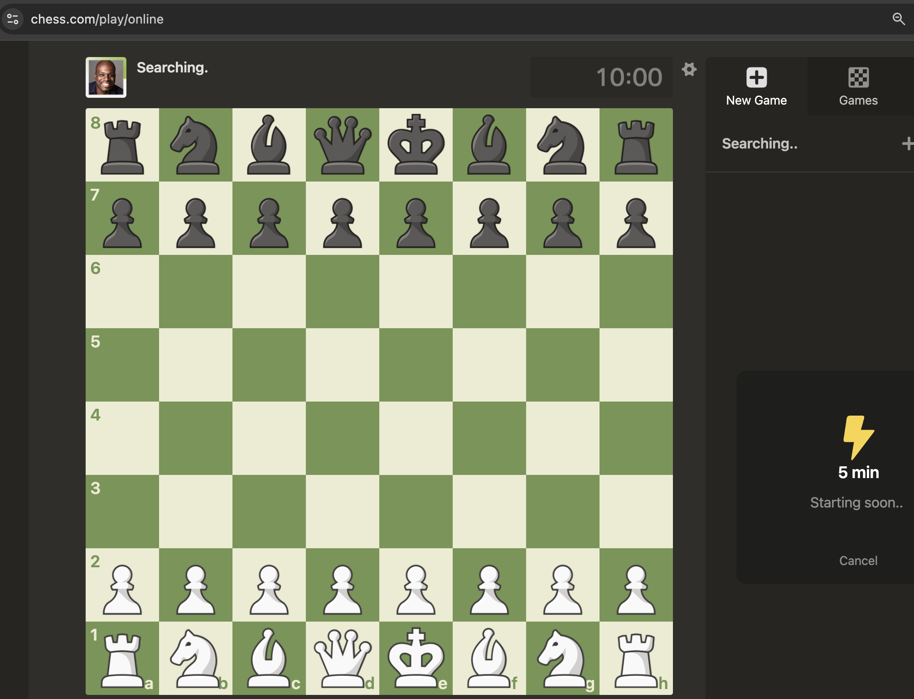
  
The live game search

???

Frame 4 (David’s slide): the live game search screen, where a player asks for a game and the platform finds an opponent. Frame 5: the opponent’s name, rating and flag are on the screen before the first move and throughout. Pairing is by rating and availability; there is no way to filter opponents by country. The chat panel is there to show that the counterpart’s country is part of the encounter; do not read it out, and do not draw conclusions from it.

---

name: david-05
class: native-slide, with-figure, screenshots-slide

# What a player sees

<!-- David original frame 5 -->

  <figure>
    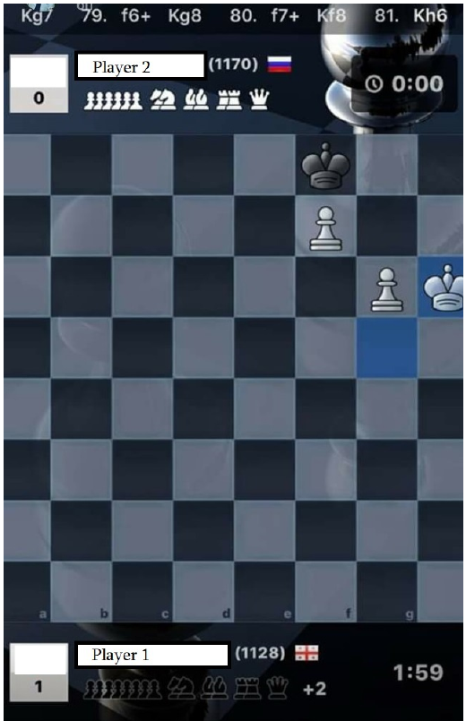
    <figcaption>A live game: ratings and flags beside the names</figcaption>
  </figure>
  <figure>
    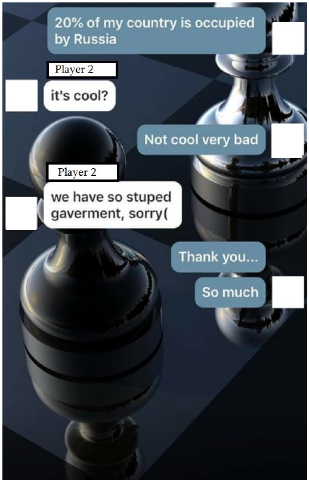
    <figcaption>In-game chat during a game</figcaption>
  </figure>

  
The opponent’s flag is visible before the first move and throughout the game.

  
Players are paired by rating and availability; there is no way to filter opponents by country.

Screenshots from the platform (May 2024 vintage); usernames and avatars removed

???

Frame 4 (David’s slide): the live game search screen, where a player asks for a game and the platform finds an opponent. Frame 5: the opponent’s name, rating and flag are on the screen before the first move and throughout. Pairing is by rating and availability; there is no way to filter opponents by country. The chat panel is there to show that the counterpart’s country is part of the encounter; do not read it out, and do not draw conclusions from it.

---

name: david-06
class: native-slide
exclude: true

# Resignation: a unilateral concession

<!-- David original frame 6 -->
- Either player may resign at any moment; the game ends at once as a loss for the resigner

- Etiquette treats resigning a clearly lost position as normal, even respectful

- Playing on in a lost position costs time and effort with little prospect of reward

- Economic theory says a contest ends when one side decides that continuing costs more than it is worth. In practice people often keep investing in a losing course of action (escalation of commitment)

- The platform records who conceded and when; for engine-analyzed games, also how lost the position was at that moment, i.e., the expected value of continuing/not-conceding

???

Either player can resign at any moment; the game ends immediately as a loss for the resigner. Etiquette treats resigning a clearly lost position as normal. Playing on in a lost position costs time and effort for little prospect of reward. For an economist: theory says a contest ends when one side decides that continuing costs more than it is worth (the war of attrition: two firms in a market that supports one, each losing money until one exits; Hendricks, Weiss and Wilson 1988). In practice people often do the opposite and keep investing in a losing course of action, which is escalation of commitment (Staw 1976: subjects who had chosen a failing investment put more money into it; meta-analysis in Sleesman et al. 2012). A lost chess position is a small version: each further move costs time and effort for almost no chance of saving the game. Two cautions if pressed: the analogy is only to the decision to stop paying, since the opponent bears no symmetric cost; and escalation of commitment is one of three readings, not a claimed mechanism. The platform records who conceded and when; for the engine-analyzed games, also how lost the position was, which is the expected value of continuing rather than conceding.

---

name: david-07
class: native-slide
exclude: true

# Research questions

<!-- David original frame 7 -->
> Does the same player concede differently to opponents displaying the opposing country’s flag once the two countries are at war?

<ol><li>
Do players treat hostile-country opponents differently once their countries are at war?
</li><li>
If so, which aspects of play change: whether they concede, how long they persist, the quality of their play, their choice of openings?
</li><li>
Does any change appear wherever war breaks out, or only in some conflicts?
</li></ol>

Three wars: Armenia–Azerbaijan (2020), Russia–Ukraine (2022), Israel–Palestine (2023). We measure behaviour rather than motives. Treatment is based on displayed flags, which we use as a proxy for national affiliation.

???

State the question in the box, then the three questions. Name the three wars. Say once: we measure behaviour, not motives; treatment is based on the displayed flag, a proxy for national affiliation. If pressed, a flag is self-chosen and not citizenship; the F AQ slide has the stability audit (94% unchanged over seven years) and the direction of any misclassification (toward zero). 2

---

name: david-08
class: native-slide

# Predictions around participation and performance are not obvious

<!-- David original frame 8 -->
- Players may refuse to play against opponents from hostile countries, or they may want to play them more

- They may refuse to draw (“victory or death”), or they may be more draw-prone (“it’s the governments’ faults, not ours”)

- They may play worse due to being distracted or emotional, or they may play better due to higher perceived stakes

- They may resign more often to avoid the displeasure of continuing a losing game to a hostile opponent, or they may resign less often to ‘fight til the end’ and/or disrespect their opponent

The literature gives no clear indication of what to expect.

???

(David’s slide) David’s own slide and wording; no script written. For reference when speaking to it, what the results later say about each pair of possibilities: playing less or more against the other side (contact fell, mostly through the supply of opponents; frames 13 and 32); refusing or seeking draws (no change in decisiveness or in any kind of draw; frame 25); playing worse or better (per-move error slightly lower, performance relative to ratings unchanged; frame 29); resigning more or less (less; frames 19–20).

---

name: david-09
class: native-slide, with-figure

# Three conflicts

<!-- David original frame 9 -->

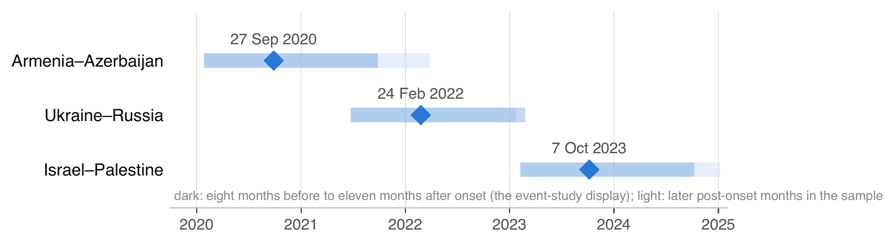

- Treatment timing is the onset of each war, applied as an exact date

- Main analysis window (dark band): eight months before to eleven months after each conflict’s onset; Secondary: later months in the sample (light band)

.slide-links[

[backup: the three conflicts in numbers](#bk-table1-main) [FAQ: why these conflicts?](#faq-conflicts)

]

???

Frame 9: three wars, exact onset dates; the onset is the treatment and no player determines it. Frame 10: 32.4 million games, 33,687 accounts, selected on the flags they displayed before the war; hostile games are 1.5% of the corpus and the comparison set is the same player’s other games. Chess players are not the public; the online population is very large; the estimand is a within-person change, which needs no claim about prevalence. Frame 11: two samples, blue and orange; the engine sample is the one that lets us condition on how lost a position was.

---

name: records
class: native-slide
exclude: true

# The data: 32.4 million games by 33,687 accounts

<!-- David original frame 10 -->
- Complete game records from Chess.com, a platform with more than 250 million members: who played whom and when, both ratings, every move, and how the game ended

- Accounts flagged to the belligerent countries were selected at random from a database assembled since 2018, on the flags they displayed before the conflict; every available game of each account is included

- A hostile-country game: the opponent displays the other belligerent’s flag. They are 1.5% of games; the comparison set is the same player’s games against everyone else

- Chess players are not the public (though there are many\!), and this is not a probability sample of them. The main estimand is a within-person change

.source-note[

Platform scale: Chess.com country statistics article (updated 12 August 2026).

]

.slide-links[

[backup: sampling frame](#bk-frame) [backup: hostile games and the comparison set](#bk-hostile) [FAQ: are flags citizenship?](#faq-flags)

]

???

Frame 9: three wars, exact onset dates; the onset is the treatment and no player determines it. Frame 10: 32.4 million games, 33,687 accounts, selected on the flags they displayed before the war; hostile games are 1.5% of the corpus and the comparison set is the same player’s other games. Chess players are not the public; the online population is very large; the estimand is a within-person change, which needs no claim about prevalence. Frame 11: two samples, blue and orange; the engine sample is the one that lets us condition on how lost a position was.

---

name: samples
class: native-slide, table-slide, samples-table-slide
exclude: true

# Two samples used in this paper

<!-- David original frame 11 -->
<table><thead><tr class="header"><th style="text-align: left;"><strong>Raw-record sample (primary)</strong></th><th style="text-align: left;"><strong>Engine-analyzed sample</strong></th></tr></thead><tbody><tr class="odd"><td style="text-align: left;">32.4 million games; 33,687 accounts</td><td style="text-align: left;">1.4 million games; 42,118 players</td></tr><tr class="even"><td style="text-align: left;">Every available game; no engine-based restriction</td><td style="text-align: left;">Players with more than 10 hostile-country games and more than 100 games; every hostile game kept, a random sample of other games</td></tr><tr class="odd"><td style="text-align: left;">Outcomes: how each game ended, game length</td><td style="text-align: left;">Every move evaluated by the Stockfish engine: an objective measure of each position and each move’s quality</td></tr><tr class="even"><td style="text-align: left;">Purpose: the behavioural result at scale</td><td style="text-align: left;">Purpose: corroborate the result under a different construction; condition on the objective position; test play quality and openings</td></tr></tbody></table>

- The two samples were drawn separately from the same account database; neither is a subset of the other

- Blue throughout for the raw records, orange for the engine-analyzed sample

.slide-links[

[backup: eligibility rules](#bk-eligibility) [FAQ: why two samples corroborate](#faq-independent)

]

???

Frame 9: three wars, exact onset dates; the onset is the treatment and no player determines it. Frame 10: 32.4 million games, 33,687 accounts, selected on the flags they displayed before the war; hostile games are 1.5% of the corpus and the comparison set is the same player’s other games. Chess players are not the public; the online population is very large; the estimand is a within-person change, which needs no claim about prevalence. Frame 11: two samples, blue and orange; the engine sample is the one that lets us condition on how lost a position was.

---

name: desc-sample
class: native-slide, table-slide

# The raw-record sample by conflict

<!-- David original frame 12 -->
<table><thead><tr><th rowspan="2">Conflict</th><th colspan="2">Accounts</th><th colspan="2">Player-game observations</th><th rowspan="2">Games per account (mean)</th></tr><tr><th>Number</th><th>Share</th><th>Number</th><th>Share</th></tr></thead><tbody><tr><td>Armenia–Azerbaijan</td><td>9,005</td><td>26.7%</td><td>13,363,927</td><td>37.2%</td><td>1,484</td></tr><tr><td>Ukraine–Russia</td><td>14,658</td><td>43.5%</td><td>15,668,875</td><td>43.6%</td><td>1,069</td></tr><tr><td>Israel–Palestine</td><td>10,024</td><td>29.8%</td><td>6,904,679</td><td>19.2%</td><td>689</td></tr><tr><td>Pooled</td><td>33,687</td><td>100%</td><td>35,937,481</td><td>100%</td><td>1,067</td></tr></tbody></table>

- A player-game observation is one sampled player’s side of one game. Ukraine–Russia contributes the most accounts and the most observations

- Games per account is observations divided by accounts over the whole sample window. It is a mean: activity differs greatly across players, which is why we report estimates weighted per game and per player

.slide-links[

[backup: Table 1 with physical games](#bk-table1-main) [backup: counting conventions](#bk-table1)

]

???

Who is in the data. 33,687 accounts and about 36 million player-game observations; an observation is one sampled player’s side of one game. Ukraine–Russia is the largest conflict on both counts: 44% of accounts and 44% of observations. Armenia–Azerbaijan has 27% of accounts but 37% of observations, because its accounts play more; Israel–Palestine has 30% of accounts and 19% of observations. On average an account contributes about a thousand games, but that is a mean and activity is very unequal, which is why every result is reported per game and per player. Medians are not in the frozen outputs (asked of Eren).

---

name: desc-contact
class: native-slide, with-figure

# How often players meet the other side

<!-- David original frame 13 -->

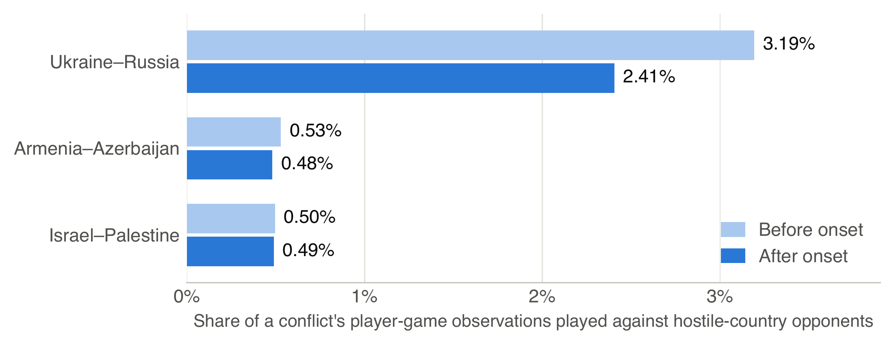

- Hostile-country games are rare. Before onset they were about 2% of player-game observations (1.98% pooled); 18,852 accounts played at least one. The same players’ other games are the comparison set

- The share is lower after onset, most clearly in Ukraine–Russia: many Ukrainian players stopped playing in the first weeks of the war, and Russia blocked the platform on 23 April 2022. Whether players also avoided these games is taken up under Limitations

.slide-links[

[backup: Ukraine–Russia month by month](#bk-contact) [backup: hostile games and the comparison set](#bk-hostile) [limitations](#flags)

]

???

Hostile-country games are rare: about 2% of observations before onset, 3.2% in Ukraine–Russia and about half a percent in the other two conflicts. Everything else a player plays is the comparison set. The dark bars show the share after onset. It is lower, clearly so in Ukraine–Russia (3.19% to 2.41%). The main reason is supply: many Ukrainian players stopped playing in the first weeks of the war, and Russia blocked the platform on 23 April 2022. I come back to whether players also avoided these games under Limitations. Do not say the share “did not change”, and do not quote the regression numbers from Eren’s run (not adopted): raw fall about 18% pooled; after allowing for the other side’s activity about 1% pooled per player-month, but 7% to 11% in Ukraine–Russia. Details: docs/20261005_engagement_run_check.md. If asked which accounts the estimate comes from: every account is in the regression, but accounts with no hostile-country games only help pin down the month effects and rating controls. The estimate is driven by accounts with hostile-country games both before and after onset. In the raw records 18,852 accounts had such a game before onset and 14,151 after; the overlap is not in the frozen outputs. In the engine-analyzed sample 22,473 players have both, and restricting to them gives −0.46 pp against −0.45 pp for everyone (exploratory). Units: these are shares of player-game observations, by conflict, from the frozen cell counts. They are not the average of each player’s own share; that per-player figure is not in the frozen outputs. If the selection question comes here, go to the backup slide “Ukraine–Russia, contact with the other side month by month” (linked from this slide and from Limitations) and say three things. First, there is no drop at onset: the Ukrainian-side share steps down in May 2022, the first full month after the block, and is flat afterwards. Second, the Russian-side share dips in March, when many Ukrainians had stopped playing, and is back at its pre-war level from May to September; a game left before the first move disappears from both players’ records, so avoidance would lower both series together. Third, we cannot observe such games, so avoidance is not excluded. Spoken answers only, exploratory, engine-analyzed sample, not on any slide (docs/20261005_contact_decline_checks.md): in Ukraine–Russia the concession estimate is −0.60 pp (p = .036) between onset and the block and −0.28 pp (p = .15) afterwards, so it does not depend on the thinned pool; players lost hostile-country games as often as before (−0.12 pp, p = .54) and the rating gap moved by about one rating point; Israel–Palestine, where contact did not change, has the largest estimate. Do not claim the effect for both sides separately: by flag it is −0.49 pp (p = .026) for Ukrainian-flag players and −0.20 pp (p = .46) for Russian-flag players.

---

name: desc-balance
class: native-slide, table-slide
exclude: true

# Hostile-country games and other games before the war

<!-- David original frame 14 -->
<table><thead><tr class="header"><th style="text-align: left;">Before onset, raw-record sample, three conflicts pooled</th><th style="text-align: right;">Hostile-country games</th><th style="text-align: right;">All other games</th></tr></thead><tbody><tr class="odd"><td style="text-align: left;">Player-game observations</td><td style="text-align: right;">0.41 million</td><td style="text-align: right;">20.33 million</td></tr><tr class="even"><td style="text-align: left;">Accounts with at least one such game</td><td style="text-align: right;">18,852</td><td style="text-align: right;">32,584</td></tr><tr class="odd"><td style="text-align: left;">The player resigned</td><td style="text-align: right;">21.46%</td><td style="text-align: right;">20.34%</td></tr><tr class="even"><td style="text-align: left;">The game ended in a resignation by either player</td><td style="text-align: right;">43.26%</td><td style="text-align: right;">41.43%</td></tr><tr class="odd"><td style="text-align: left;">Game length (moves)</td><td style="text-align: right;">35.9</td><td style="text-align: right;">35.0</td></tr></tbody></table>

- Before the war, hostile-country games already differed a little from other games

- The design does not need the two kinds of game to look alike. It needs the gap between them to have stayed the same had the war not begun; the estimate is the change in that gap

.slide-links[

[backup: the comparison set](#bk-hostile)

]

???

seconds) Before the war the two kinds of game were similar but not identical: the player resigned in 21.5% of hostile-country games and 20.3% of other games, and hostile-country games were about one move longer. That is fine. The design does not require the two to look alike; it requires the gap between them to have stayed the same had the war not begun, and the estimate is the change in that gap. This sets up the next slide. If asked about ratings or time controls by cell: not in the frozen outputs; ratings are controlled in every regression. If asked whether the pre-war difference in resignation is significant: yes, but its sign depends on the comparison (not on the slide, at David’s request). The table shows raw pooled means: 21.46% against 20.34%, a gap of +1.1 pp, far outside sampling error with 410,000 hostile-country observations. That raw gap is mostly composition: Ukraine–Russia supplies most hostile-country games and its players resign more in all their games. Within the same player, which is the comparison the design uses, hostile- country games had slightly FEWER resignations before the war: −0.25 pp (SE 0.08, p = .001; the Hostile coefficient in the headline regression, frozen). By conflict within player: Armenia–Azerbaijan −1.57 pp (p < .0001), Ukraine–Russia −0.17 pp (p = .049), Israel–Palestine +0.69 pp (p = .053). Within player, hostile-country games were also slightly longer (+0.17 moves, p < .0001). None of this is a problem for the design, which needs a stable gap, not a zero gap; the flat pre-onset bins are the evidence for that.

---

name: comparison
class: native-slide

# Estimation: the same player, two kinds of opponent, before and after

<!-- David original frame 15 -->
<table class="comparison-table"><thead><tr><th></th><th>Before onset</th><th>After onset</th></tr></thead><tbody><tr><th>Hostile-country opponents</th><td>Hostile-country opponents</td><td class="treated">Hostile-country opponents</td></tr><tr><th>All other opponents</th><td>All other opponents</td><td>All other opponents</td></tr></tbody></table>

Estimate: how much the gap between the rows changed after onset

- Within each player and each calendar month of each conflict: player fixed effects absorb everything stable about a player; conflict-by-month effects absorb activity waves and platform-wide shocks; both ratings controlled; standard errors clustered by player

- The assumption: without the onset, the gap between a player’s hostile-country games and their other games would have followed a similar path

.slide-links[

[backup: what the fixed effects absorb](#bk-fe) [backup: identification in words](#bk-ident) [FAQ: why a linear model?](#faq-lpm)

]

???

(about 90 seconds) Point at the four cells. The estimate is how much the gap between the two rows changed after on- set, within each player and within each calendar month of each conflict. Player fixed effects absorb everything stable about a player; conflict-by-month effects absorb activity waves and platform shocks; both ratings are controlled. The assumption, in one sentence: without the onset, the gap would have followed a similar path.

---

name: before
class: native-slide, with-figure

# Before onset: no pre-trend

<!-- David original frame 17 -->

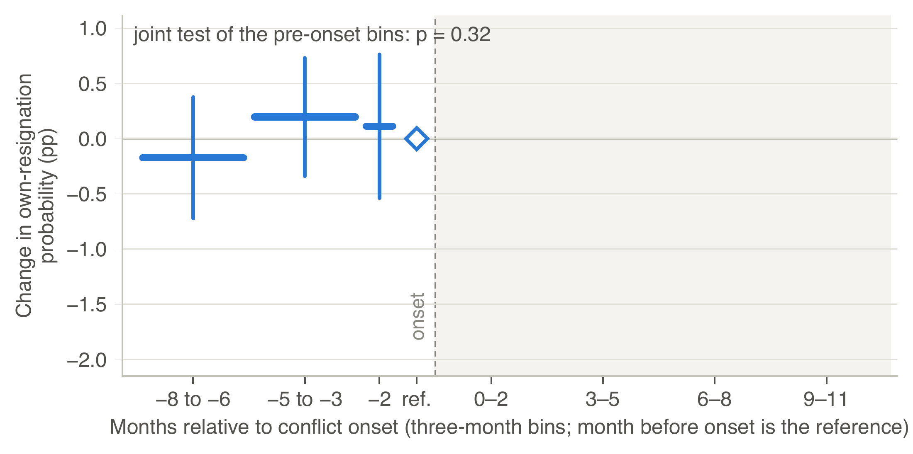

- Each bar: the change in the gap in that three-month bin relative to the month before onset (“ref.”); zero means no change; the vertical lines are 95% confidence intervals

- The three pre-onset bins are jointly indistinguishable from zero (<math display="inline" xmlns="http://www.w3.org/1998/Math/MathML"><semantics><mrow><mi>p</mi><mo>=</mo><mn>.32</mn></mrow></semantics></math>)

.slide-links[

[backup: monthly version](#bk-monthly) [backup: per-conflict tests](#bk-pretrends) [FAQ: why should these be zero?](#faq-pretrends)

]

???

Frame 17: each bar is the change in the gap in that three-month bin relative to the month before onset; zero is no change; the lines are confidence intervals. Before onset, nothing (jointly indistinguishable from zero). Frame 18: after onset, every bin negative; the dashed line is the full post-period estimate, which is the per-game number on the next slide; months six to eight sit near zero and the largest decline is in months nine to eleven; the display stops where the largest conflict leaves the window. Do not say the effect grows steadily. If asked why the pre-onset bins need to be zero when the design already differences out the gap (F AQ slide, linked from frame 17, titled “Before onset: no pre-trend”; this is the pre-trends check for parallel trends): the design removes a difference in levels, not in trends. The level of the gap may differ from zero and does (within player, −0.25 pp before the war). What the bars show is the change in the gap relative to the month before onset, and that must be zero, because the one assumption is that the gap would have stayed put without the war. If the gap had already been drifting, the comparison of after with before would pick up the drift and call it an effect. The three pre-onset bins are −0.17, +0.20 and +0.11 pp (standard errors about 0.3 pp each), alternating in sign, jointly p = .32. Honest limits: not rejecting zero is not proof, since each bin is only as precise as a post-onset bin; and flat bins cannot rule out a shock exactly at onset specific to hostile pairings.

---

name: after
class: native-slide, with-figure

# After onset: negative in every bin

<!-- David original frame 18 -->

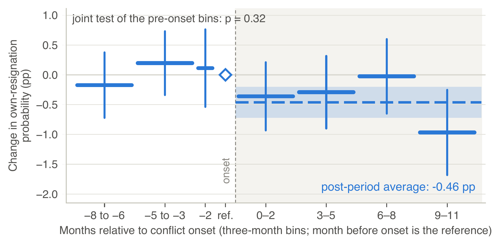

- Every post-onset bin is negative; the dashed line is the full post-period estimate (<math display="inline" xmlns="http://www.w3.org/1998/Math/MathML"><semantics><mrow><mo>−</mo><mn>0.46</mn></mrow></semantics></math> pp, each game equally); months 6–8 sit near zero and the largest decline is in months 9–11

- The display stops at month 11, where Ukraine–Russia, the largest conflict, leaves the window; later bins rest on fewer conflicts

.slide-links[

[backup: bins to month 17](#bk-fullwindow)

]

???

Frame 17: each bar is the change in the gap in that three-month bin relative to the month before onset; zero is no change; the lines are confidence intervals. Before onset, nothing (jointly indistinguishable from zero). Frame 18: after onset, every bin negative; the dashed line is the full post-period estimate, which is the per-game number on the next slide; months six to eight sit near zero and the largest decline is in months nine to eleven; the display stops where the largest conflict leaves the window. Do not say the effect grows steadily. If asked why the pre-onset bins need to be zero when the design already differences out the gap (F AQ slide, linked from frame 17, titled “Before onset: no pre-trend”; this is the pre-trends check for parallel trends): the design removes a difference in levels, not in trends. The level of the gap may differ from zero and does (within player, −0.25 pp before the war). What the bars show is the change in the gap relative to the month before onset, and that must be zero, because the one assumption is that the gap would have stayed put without the war. If the gap had already been drifting, the comparison of after with before would pick up the drift and call it an effect. The three pre-onset bins are −0.17, +0.20 and +0.11 pp (standard errors about 0.3 pp each), alternating in sign, jointly p = .32. Honest limits: not rejecting zero is not proof, since each bin is only as precise as a post-onset bin; and flat bins cannot rule out a shock exactly at onset specific to hostile pairings.

---

name: headline
class: native-slide, with-figure

# Players conceded less often to hostile-country opponents after war began

<!-- David original frame 19 -->

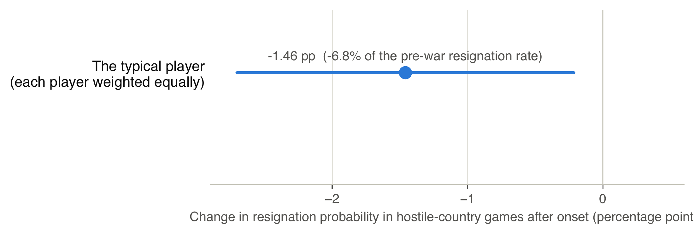

- Same player, hostile-country games versus all their other games, after versus before onset; each player weighted equally: <math display="inline" xmlns="http://www.w3.org/1998/Math/MathML"><semantics><mrow><mo>−</mo><mn>1.46</mn></mrow></semantics></math> percentage points, 6.8% of the pre-war resignation rate in hostile-country games (SE 0.64 pp, <math display="inline" xmlns="http://www.w3.org/1998/Math/MathML"><semantics><mrow><mi>p</mi><mo>=</mo><mn>.022</mn></mrow></semantics></math>). Roughly 3 fewer resignations in every 100 games the player loses (next slide)

.slide-links[

[FAQ: what does this mean concretely?](#faq-magnitude)

]

???

Build 1. Here is the full statement of what the bins showed. Same player, their games against opponents showing the hostile country’s flag versus their games against everyone else, after versus before the war began, with player and conflict-by-month fixed effects. Weighting every player equally, the typical player’s probability of resigning a hostile-country game fell by one point four six percentage points, six point eight percent of the pre-war rate. The next slide puts a scale on that number. Build 2. Counting every game equally instead, the decline is nought point four six percentage points, about two percent, about one fewer resignation in every hundred lost games; that is the dashed line on the previous slide. That average is dominated by the most active players. Both are negative; the gap between them is itself a finding, which comes after the scale slide. And it is not every war: Armenia–Azerbaijan shows no detectable change, which I come to.

---

name: headline-more
class: native-slide, with-figure
count: false

# Players conceded less often to hostile-country opponents after war began

<!-- David original frame 19 -->

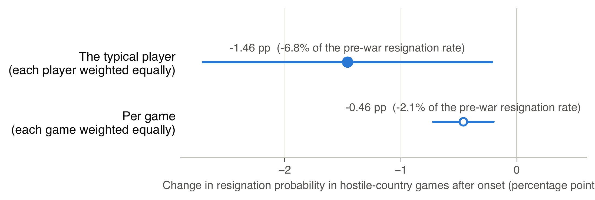

- Same player, hostile-country games versus all their other games, after versus before onset; each player weighted equally: <math display="inline" xmlns="http://www.w3.org/1998/Math/MathML"><semantics><mrow><mo>−</mo><mn>1.46</mn></mrow></semantics></math> percentage points, 6.8% of the pre-war resignation rate in hostile-country games (SE 0.64 pp, <math display="inline" xmlns="http://www.w3.org/1998/Math/MathML"><semantics><mrow><mi>p</mi><mo>=</mo><mn>.022</mn></mrow></semantics></math>). Roughly 3 fewer resignations in every 100 games the player loses (next slide)

- Each game weighted equally, an average dominated by the most active players: <math display="inline" xmlns="http://www.w3.org/1998/Math/MathML"><semantics><mrow><mo>−</mo><mn>0.46</mn></mrow></semantics></math> pp, 2.1% of the pre-war rate (SE 0.13 pp, <math display="inline" xmlns="http://www.w3.org/1998/Math/MathML"><semantics><mrow><mi>p</mi><mo>=</mo><mn>.0005</mn></mrow></semantics></math>)

- Not in every war: Armenia–Azerbaijan shows no detectable change (coming up)

.slide-links[

[FAQ: what does this mean concretely?](#faq-magnitude)

]

???

Build 1. Here is the full statement of what the bins showed. Same player, their games against opponents showing the hostile country’s flag versus their games against everyone else, after versus before the war began, with player and conflict-by-month fixed effects. Weighting every player equally, the typical player’s probability of resigning a hostile-country game fell by one point four six percentage points, six point eight percent of the pre-war rate. The next slide puts a scale on that number. Build 2. Counting every game equally instead, the decline is nought point four six percentage points, about two percent, about one fewer resignation in every hundred lost games; that is the dashed line on the previous slide. That average is dominated by the most active players. Both are negative; the gap between them is itself a finding, which comes after the scale slide. And it is not every war: Armenia–Azerbaijan shows no detectable change, which I come to.

---

name: scale
class: native-slide, with-figure

# How big is that? Measured against the games a player loses

<!-- David original frame 20 -->

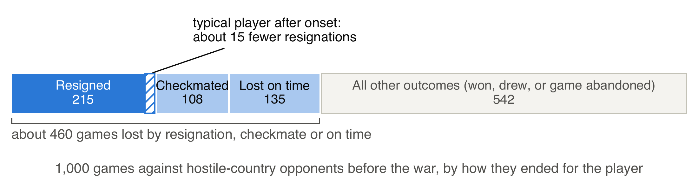

- A player almost always only resigns games they are losing. Before the war players lost about 460 of every 1,000 hostile-country games by resignation, checkmate or on time; about 215 of those were resignations, about 47% of lost games

- The typical player after onset resigned about 15 fewer of those games: about 200 of the 460 lost games ended with a resignation instead of 215. That is about 44% of lost games instead of 47%, or roughly 3 fewer resignations in every 100 lost games

- The losses did not become rarer; they ended differently, in checkmate or on the clock (coming up)

.slide-links[

[FAQ: the arithmetic, step by step](#faq-magnitude) [where the concessions went](#endings)

]

???

90 seconds) Point at the bar: a thousand hostile-country games before the war, sorted by how they ended for the player. A player almost always resigns only games they are losing, so the right yardstick is lost games, not all games. Out of a thousand hostile-country games a player lost about 460 by resignation, checkmate or on time: about 215 by resigning, 108 by checkmate and 135 on time. (A few more are lost in abandoned games; those are not in the raw-record file, so they sit in the grey segment.) So resignation ended about 47% of lost games. The estimate takes about 15 of the 215 away, leaving about 200. So 200 of the 460 lost games ended in resignation instead of 215: about 44% of lost games instead of 47%. Said a third way, 15 out of 460 is roughly three fewer resignations in every hundred lost games. The losses did not become rarer; they ended differently, which is the next section of the talk. The hatched sliver on the bar is those 15 games. Weighting each game equally it is about 5 fewer, about 46% of lost games. What the 6.8% is: the 1.46 pp fall divided by the pre-war LEVEL of resignation in hostile-country games (21.46%), not by the pre-war gap between hostile and other games. In words: before the war a player resigned about 21.5 of every 100 hostile-country games; judged against the same player’s other games over the same months, that became about 20 after onset; 1.46 out of 21.46 is 6.8%, about one resignation in fifteen. The pre-war gap is a different and much smaller number (−0.25 pp within player), so the effect is several times the gap. Units reminder: say “percentage points” for the estimate and “percent of the pre-war rate” for the relative figure; never mix them. The 6.8% does not depend on the yardstick (15 out of 215 either way). The 47% and 44% combine the per-player estimate with pooled baselines, the same convention the paper uses for the 6.8%. If asked whether losses changed: per game, resignations −0.46 pp, checkmated +0.22, lost on time +0.37, so these three together moved by about +0.1 pp.

---

name: byconflict
class: native-slide, with-figure

# By conflict

<!-- David original frame 22 -->

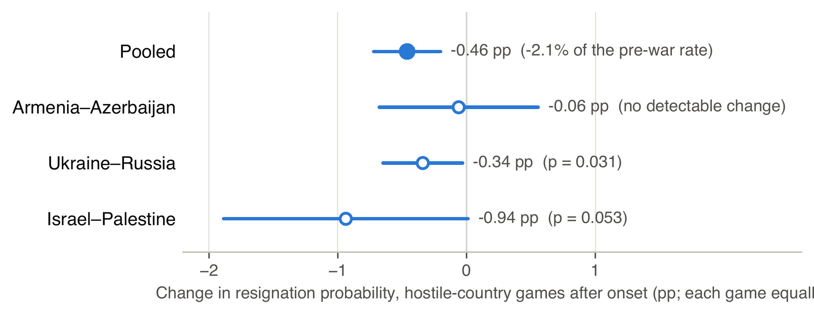

- Ukraine–Russia and Israel–Palestine decline; Armenia–Azerbaijan shows no detectable change. Dropping any one conflict leaves the pooled estimate negative

.slide-links[

[backup: both samples by conflict](#bk-forest-full) [backup: leave-one-conflict-out](#bk-loo)

]

???

(about 3 minutes) Frame 22: Ukraine–Russia and Israel–Palestine decline, the latter imprecisely; Armenia– Azerbaijan no detectable change; dropping any one conflict leaves the pooled estimate negative. Frame 23: a possible explanation we cannot test in our data: a ceasefire about six weeks after onset. This conflict moves on a different margin, openings. If asked about recoding the post-ceasefire months: tested, exploratory; it leaves far too few hostile games to estimate anything and does not strengthen the pooled estimate. Frame 24: the separately built engine sample reproduces the per-game estimate almost exactly, and the per-conflict pattern and the weighting contrast; say “separately constructed”, not “independent” .

---

name: boundary
class: native-slide
exclude: true

# Armenia–Azerbaijan

<!-- David original frame 23 -->
- No detectable change in resignation in either sample: <math display="inline" xmlns="http://www.w3.org/1998/Math/MathML"><semantics><mrow><mo>−</mo><mn>0.06</mn></mrow></semantics></math> pp (<math display="inline" xmlns="http://www.w3.org/1998/Math/MathML"><semantics><mrow><mi>p</mi><mo>=</mo><mn>.85</mn></mrow></semantics></math>) in the raw records, <math display="inline" xmlns="http://www.w3.org/1998/Math/MathML"><semantics><mrow><mo>+</mo><mn>0.12</mn></mrow></semantics></math> pp (<math display="inline" xmlns="http://www.w3.org/1998/Math/MathML"><semantics><mrow><mi>p</mi><mo>=</mo><mn>.78</mn></mrow></semantics></math>) in the engine-analyzed sample

- Possible explanation (not testable in our data): active hostilities ended with a ceasefire about six weeks after onset, so most of the post-onset window lies after the fighting had ceased

- This conflict moves on a different margin, departures from habitual openings (later)

.slide-links[

[backup: game length in this dyad](#bk-aalength) [FAQ: why is it null?](#faq-aa)

]

???

(about 3 minutes) Frame 22: Ukraine–Russia and Israel–Palestine decline, the latter imprecisely; Armenia– Azerbaijan no detectable change; dropping any one conflict leaves the pooled estimate negative. Frame 23: a possible explanation we cannot test in our data: a ceasefire about six weeks after onset. This conflict moves on a different margin, openings. If asked about recoding the post-ceasefire months: tested, exploratory; it leaves far too few hostile games to estimate anything and does not strengthen the pooled estimate. Frame 24: the separately built engine sample reproduces the per-game estimate almost exactly, and the per-conflict pattern and the weighting contrast; say “separately constructed”, not “independent” .

---

name: corroboration
class: native-slide, with-figure
exclude: true

# Consistency of results across samples

<!-- David original frame 24 -->

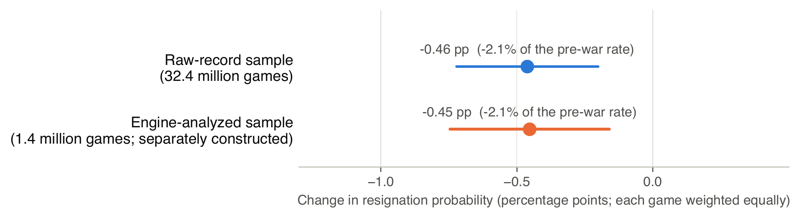

- Different eligibility rules, different sampling of comparison games, a different data path; the per-game estimate reproduces almost exactly, and so do the per-conflict pattern and the weighting contrast (each player equally: <math display="inline" xmlns="http://www.w3.org/1998/Math/MathML"><semantics><mrow><mo>−</mo><mn>1.13</mn></mrow></semantics></math> pp, about 2.5 times the per-game estimate)

.slide-links[

[backup: by conflict, both samples](#bk-forest-full) [FAQ: why this counts as corroboration](#faq-independent)

]

???

(about 3 minutes) Frame 22: Ukraine–Russia and Israel–Palestine decline, the latter imprecisely; Armenia– Azerbaijan no detectable change; dropping any one conflict leaves the pooled estimate negative. Frame 23: a possible explanation we cannot test in our data: a ceasefire about six weeks after onset. This conflict moves on a different margin, openings. If asked about recoding the post-ceasefire months: tested, exploratory; it leaves far too few hostile games to estimate anything and does not strengthen the pooled estimate. Frame 24: the separately built engine sample reproduces the per-game estimate almost exactly, and the per-conflict pattern and the weighting contrast; say “separately constructed”, not “independent” .

---

name: endings
class: native-slide, with-figure

# Where the missing concessions went: checkmate, or the clock

<!-- David original frame 25 -->

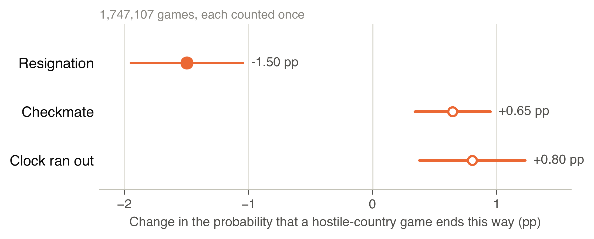

- Each game counted once: resignation endings fell by 1.50 pp; checkmates rose by 0.65 and losses on time by 0.80, together <math display="inline" xmlns="http://www.w3.org/1998/Math/MathML"><semantics><mrow><mo>+</mo><mn>1.45</mn></mrow></semantics></math> pp. Games that would have ended in concession ran on to checkmate or until a clock ran out

- Whether games were decisive, and every kind of draw, did not change; games became slightly longer (<math display="inline" xmlns="http://www.w3.org/1998/Math/MathML"><semantics><mrow><mo>+</mo><mn>0.45</mn></mrow></semantics></math> moves) as a result

.slide-links[

[backup: draws and game length](#bk-composition-full) [backup: game-level estimation](#bk-gamelevel)

]

???

Each game counted once. Resignation endings fell by one and a half points; checkmates rose by nought point six five and losses on time by nought point eight, together one point four five. Games that would have ended in concession ran on to checkmate or until a clock ran out. Draws and decisiveness did not change; games got slightly longer as a result. Say “where the endings moved, not why” .

---

name: endings
class: native-slide, with-figure

# Where the missing concessions went, by gender

<!-- Gender breakdown of David original frame 25 -->

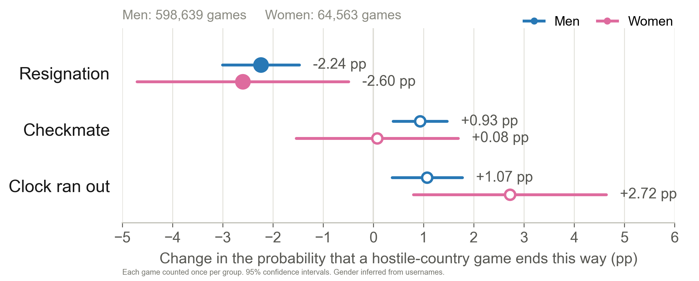

- **Men:** resignation endings fell by 2.24 pp. Checkmates rose by 0.93 pp and losses on time by 1.07 pp

- **Women:** resignation endings fell by 2.60 pp and losses on time rose by 2.72 pp. No detectable change in checkmate (+0.08 pp)

.slide-links[

[backup: draws and game length](#bk-composition-full) [backup: game-level estimation](#bk-gamelevel)

]

???

Blue is men, pink is women. All classified men are included without user sampling. Gender is inferred from usernames.

Each physical game is counted once within each gender group, using the corrected game key. A mixed-gender game can appear once in each group.

Both groups show fewer resignation endings. For men, both checkmate and clock endings increase. For women, the detectable increase is in clock endings.

These are separate within-group estimates, not a formal test that men and women differ. The accounting does not identify which individual games switched endings.

---

name: endings-elo
class: native-slide, with-figure

# Where the missing concessions went, by Elo

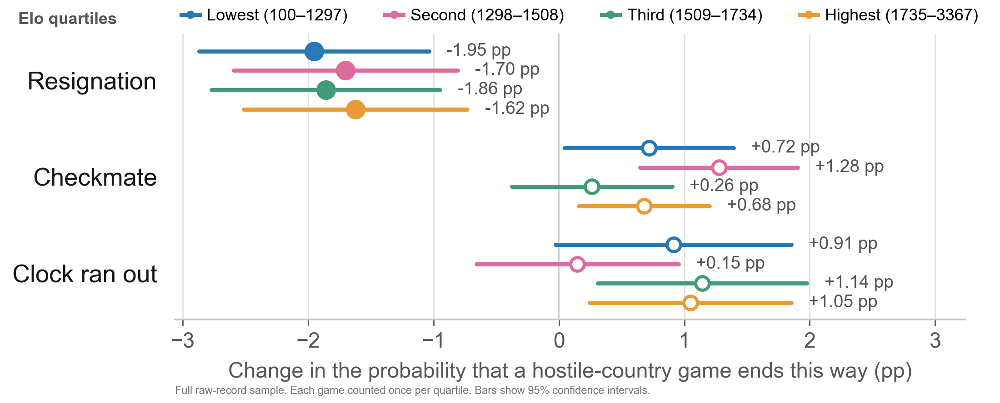

- **Resignation:** endings fell in every Elo quartile, by 1.62–1.95 pp

- **Other endings:** detectable increases in checkmate in the lowest, second, and highest quartiles; in clock endings in the third and highest quartiles

.slide-links[

[backup: draws and game length](#bk-composition-full) [backup: game-level estimation](#bk-gamelevel)

]

???

Blue is the lowest Elo quartile (100–1297), pink the second (1298–1508), green the third (1509–1734), and orange the highest (1735–3367).

Full raw-record sample. Quartiles use the focal player's rating in each game, with the same cutoffs as the earlier Elo graph. A player can contribute to multiple quartiles.

Each physical game is counted once within each quartile. A game with eligible focal players in different quartiles can appear once in each group.

Resignation endings decline detectably in all four quartiles. Checkmate increases are detectable in the lowest, second, and highest quartiles. Clock increases are detectable in the third and highest quartiles. The lowest-quartile clock estimate is also positive (+0.91 pp), but its confidence interval includes zero.

These are separate within-group estimates, not a formal test of differences between quartiles. Different significance levels do not establish that groups differ. The accounting does not identify which individual games switched endings.

---

name: endings-time-control
class: native-slide, with-figure

# Where the missing concessions went, by speed

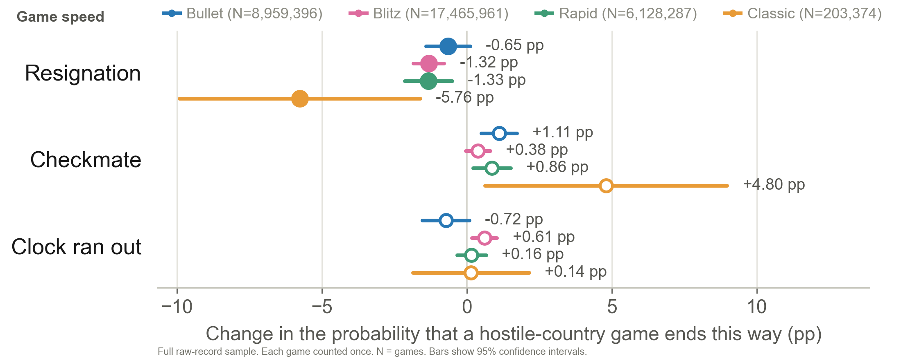

- **Blitz and Rapid:** resignation endings fell by 1.32 and 1.33 pp. Clock endings rose in Blitz (+0.61 pp); checkmates rose in Rapid (+0.86 pp)

- **Classic:** fewer resignations (−5.76 pp), more checkmates (+4.80 pp). **Bullet:** more checkmates (+1.11 pp), with no detectable change in resignation or clock endings

.slide-links[

[backup: draws and game length](#bk-composition-full) [backup: game-level estimation](#bk-gamelevel)

]

???

Blue is Bullet, pink Blitz, green Rapid, and orange Classic. Grey counts above the graph give the number of unique games used in each speed regression.

Full raw-record sample, using the same game-level specification as the Elo endings graph. Each physical game is counted once and belongs to exactly one speed group.

Speed categories follow the paper's initial-time definitions, ignoring increments: Bullet up to 2 minutes; Blitz over 2 through 5 minutes; Rapid over 5 through 20 minutes; Classic over 20 minutes.

Blitz and Rapid show fewer resignation endings. The detectable increase is in clock endings for Blitz and checkmate for Rapid. Classic shows fewer resignations and more checkmates, with much wider confidence intervals and a smaller sample. Bullet shows more checkmates; its resignation and clock estimates are not significant at 5%.

These are separate within-group estimates, not a formal test of differences between speeds. The accounting does not identify which individual games switched endings.

---

name: lostdef
class: native-slide, with-figure
exclude: true

# Measuring continuation after a position is lost

<!-- David original frame 26 -->

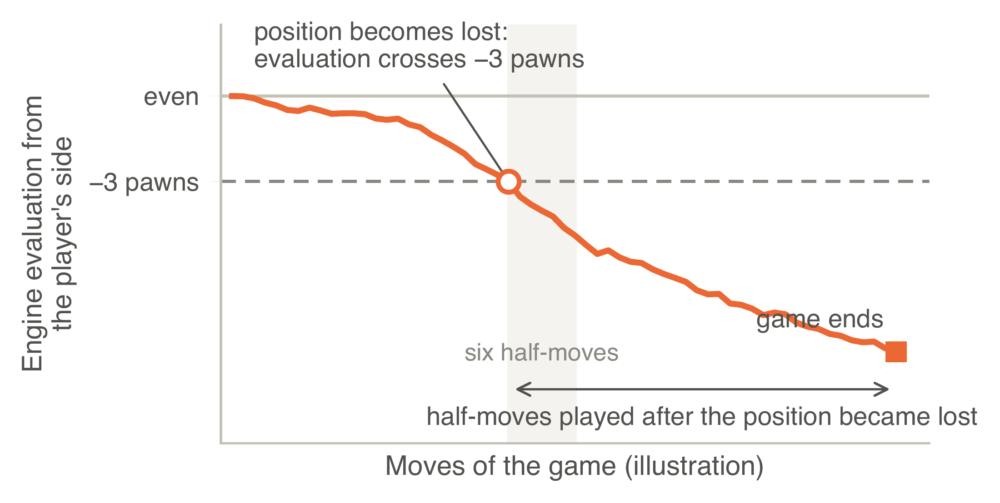

- The engine evaluates every position. A position counts as lost when the evaluation first falls to three pawns or worse against the player, which at these levels is almost always decisive

- The risk set is every game in which that happened: 1,115,113 player-game observations from 35,925 players. Membership never depends on how the game ended

- Two measures of continuing: the half-moves played after the position became lost, and whether the player went on for more than six half-moves

.slide-links[

[FAQ: half-moves, pawns, centipawns](#faq-glossary)

]

???

Frame 26 (definition, the schematic): the engine evaluates every position; lost means three pawns or worse against the player, almost always decisive at these levels; the risk set is every game where that happened, and membership never depends on how the game ended. Two measures: half-moves after the position became lost, and continuing beyond six half-moves. Frame 27: plus nought point two eight eight half-moves per lost game, one point seven percent more, and more likely to continue beyond six half-moves. The cost falls on the persister. Frame 28 (robustness): the same games became lost (entry into the risk set unchanged), and the evaluation at which players resigned did not change, so they did not move their threshold.

---

name: persistence
class: native-slide, with-figure

# Players fought on longer in positions that were already lost

<!-- David original frame 27 -->

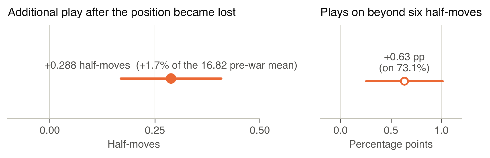

- Against hostile-country opponents after onset, players played <math display="inline" xmlns="http://www.w3.org/1998/Math/MathML"><semantics><mrow><mo>+</mo><mn>0.288</mn></mrow></semantics></math> more half-moves per lost game (SE 0.061, <math display="inline" xmlns="http://www.w3.org/1998/Math/MathML"><semantics><mrow><mi>p</mi><mo>&lt;</mo><mn>.0001</mn></mrow></semantics></math>), a 1.7% increase on the pre-war mean, and were more likely to continue beyond six half-moves (<math display="inline" xmlns="http://www.w3.org/1998/Math/MathML"><semantics><mrow><mo>+</mo><mn>0.63</mn></mrow></semantics></math> pp on 73.05%, <math display="inline" xmlns="http://www.w3.org/1998/Math/MathML"><semantics><mrow><mi>p</mi><mo>=</mo><mn>.0011</mn></mrow></semantics></math>)

- The cost falls on the persister: time and effort in positions offering essentially no prospect of reward

.slide-links[

[backup: all persistence measures](#bk-persistence-full) [backup: by conflict](#bk-persistconflict)

]

???

Frame 26 (definition, the schematic): the engine evaluates every position; lost means three pawns or worse against the player, almost always decisive at these levels; the risk set is every game where that happened, and membership never depends on how the game ended. Two measures: half-moves after the position became lost, and continuing beyond six half-moves. Frame 27: plus nought point two eight eight half-moves per lost game, one point seven percent more, and more likely to continue beyond six half-moves. The cost falls on the persister. Frame 28 (robustness): the same games became lost (entry into the risk set unchanged), and the evaluation at which players resigned did not change, so they did not move their threshold.

---

name: checks
class: native-slide, with-figure

# Robustness: the same games became lost, and players did not move their threshold

<!-- David original frame 28 -->

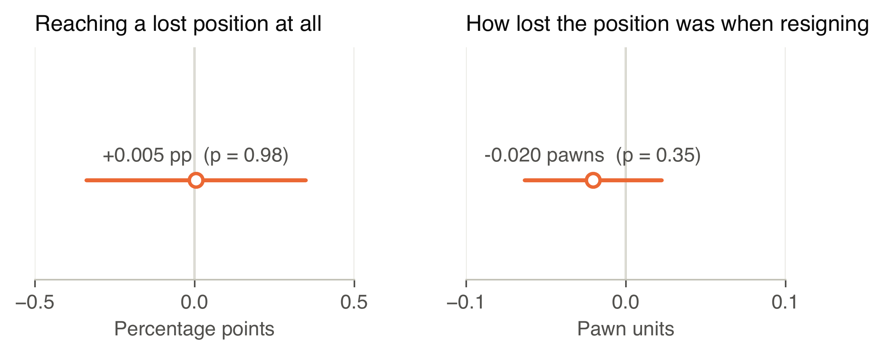

- The probability that a game ever reached a lost position did not change, so the extra persistence is not more games entering the risk set

- The engine’s evaluation at the moment a player resigned did not change, so players did not simply relocate the point at which they give up

.slide-links[

[backup: by rating](#bk-rating) [FAQ: could it be worse play?](#faq-worseplay)

]

???

Frame 26 (definition, the schematic): the engine evaluates every position; lost means three pawns or worse against the player, almost always decisive at these levels; the risk set is every game where that happened, and membership never depends on how the game ended. Two measures: half-moves after the position became lost, and continuing beyond six half-moves. Frame 27: plus nought point two eight eight half-moves per lost game, one point seven percent more, and more likely to continue beyond six half-moves. The cost falls on the persister. Frame 28 (robustness): the same games became lost (entry into the risk set unchanged), and the evaluation at which players resigned did not change, so they did not move their threshold.

---

name: quality
class: native-slide, with-figure

# Move quality: do players play worse?

<!-- David original frame 29 -->

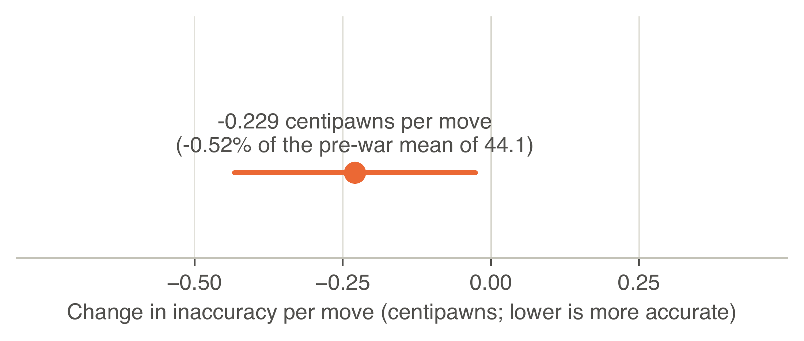

- The engine scores every move against its best move; the per-move error fell slightly in hostile-country games after onset (SE 0.104, <math display="inline" xmlns="http://www.w3.org/1998/Math/MathML"><semantics><mrow><mi>p</mi><mo>=</mo><mn>.027</mn></mrow></semantics></math>), and performance relative to what the ratings predicted did not change (<math display="inline" xmlns="http://www.w3.org/1998/Math/MathML"><semantics><mrow><mi>p</mi><mo>=</mo><mn>.83</mn></mrow></semantics></math>)

- Whatever kept players fighting in lost positions, it was not accompanied by deteriorating play

.slide-links[

[backup: three quality measures](#bk-quality-full) [backup: secondary outcomes](#bk-secondary)

]

???

No. The engine scores every move against its best move. The per-move error fell slightly; performance relative to the ratings did not change. Whatever kept players fighting, it was not accompanied by worse play. If asked about blunders: blunders per move fell slightly and mistakes per move did not change (exploratory, not in the paper); mistakes per game rose about one percent only because games are longer.

---

name: openings
class: native-slide, with-figure, dense-slide

# A different margin: departures from habitual openings

<!-- David original frame 30 -->

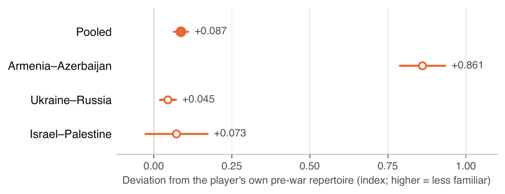

- Chess players typically stick to a familiar set of initial moves, or “openings”, that make up an individual’s “opening repertoire”

- Each opening is scored against the player’s own pre-war repertoire (minus the log of how often they had used it; <math display="inline" xmlns="http://www.w3.org/1998/Math/MathML"><semantics><mrow><mo>+</mo><mn>0.1</mn></mrow></semantics></math> is an opening used about 10% less often before the war). Hostile-country games: <math display="inline" xmlns="http://www.w3.org/1998/Math/MathML"><semantics><mrow><mo>+</mo><mn>0.087</mn></mrow></semantics></math> after onset, 2.2% of the pre-war mean (<math display="inline" xmlns="http://www.w3.org/1998/Math/MathML"><semantics><mrow><mi>p</mi><mo>&lt;</mo><mn>.0001</mn></mrow></semantics></math>)

- Armenia–Azerbaijan, which shows no resignation change, shows the biggest openings effect: players departed from their usual repertoire. If anything, the share of aggressive openings fell, but the estimate is noisy, and the share of safe openings did not rise

.slide-links[

[backup: by colour; without Armenia–Azerbaijan](#bk-openings-full) [backup: the index](#bk-openings)

]

???

Start with the first bullet for non-players: most players have a repertoire, a familiar set of first moves. Units: minus the log of how often the player had used that opening before the war; plus 0.1 is an opening used about ten percent less often. Pooled plus 0.087, 2.2% of the pre-war mean; Armenia– Azerbaijan plus 0.861, the biggest openings effect, in the conflict with no resignation change. Players departed from their habits but not toward more aggressive openings: the aggressive and safe opening shares did not change (pooled: aggressive −0.22 pp, p = .069; safe −0.04 pp; Armenia–Azerbaijan on its own: aggressive −0.41 pp with SE 0.38, safe −0.26 pp with SE 0.55, both far from significant). Do not say “less aggressive” . If asked about gambits: an exploratory test using each opening code’s pre-war draw rate shows no shift; a gambit classification would need Chess.com’s opening names.

---

name: sensitivity
class: native-slide, with-figure

# Sensitivity to analysis choices: specification curve

<!-- David original frame 31 -->

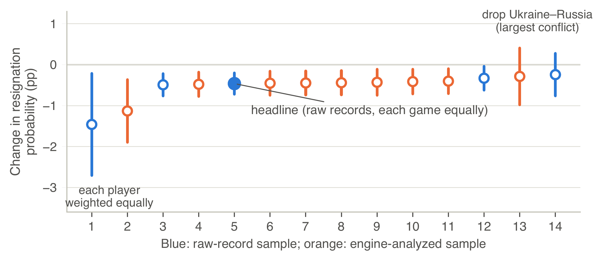

- Fourteen already-reported specifications: sample, weighting, conflicts included, fixed effects, comparison group, duplicate records. The two widest intervals drop the largest conflict; the two largest declines weight each player equally

.slide-links[

[backup: with the choice matrix](#bk-speccurve-full) [backup: dimensions tested](#bk-robust)

]

???

Fourteen already-reported specifications, every one negative. The two widest intervals drop the largest conflict; the two largest declines weight each player equally. The choice matrix and the dimensions table are one click away; do not go through them unless asked.

---

name: flags
class: native-slide, dense-slide

# Limitations

<!-- David original frame 32 -->
- A displayed flag is not necessarily citizenship. Each account is classified by one recorded flag, taken before the war for focal players, so the sample cannot respond to the war. Accounts that later changed flag are not dropped; they are few (94.0% of accounts in the full database showed the same flag seven years on). A game against an opponent who had changed flag is an untreated game counted as treated, which pulls the estimate toward zero. The largest movement, an inflow into the Palestinian flag, matters for Israel–Palestine only

- Players cannot filter opponents by country; pairing is by rating and availability. Who is online at a given moment is not fixed, and the month effects absorb only changes common to a conflict’s players

- Games aborted before the first move are not stored, so a player who leaves on seeing the flag is invisible; abandonment inside stored games did not change (<math display="inline" xmlns="http://www.w3.org/1998/Math/MathML"><semantics><mrow><mo>+</mo><mn>0.08</mn></mrow></semantics></math> pp, <math display="inline" xmlns="http://www.w3.org/1998/Math/MathML"><semantics><mrow><mi>p</mi><mo>=</mo><mn>.16</mn></mrow></semantics></math>)

- Contact with the other side fell after onset, most in Ukraine–Russia. The fall follows Russia’s block of the platform on 23 April 2022, not the onset of the war, which points to the supply of opponents; avoidance by some players cannot be ruled out

.slide-links[

[backup: contact by month](#bk-contact) [backup: threats table](#threats) [backup: flag audit](#bk-flags) [FAQ: quit on seeing the flag?](#faq-quit)

]

???

Four points. A flag is not necessarily citizenship. Each account carries one recorded flag, taken before the war for focal players. We do NOT drop accounts that changed flag later, for three reasons: we have only two readings per account (collection and September 2024) and cannot date a change; dropping on a change that may itself be a response to the war (Russian-flagged accounts left that flag at twice the average rate) would select the sample on an outcome; and the per-account list is not yet in hand. The audit covers the whole database of 3.6 million accounts, not just our sample: 94.0% showed the same flag seven years on, 3.2% moved to another flag and 2.9% had no flag at the second reading. By country, any change: Russia 9.0%, Ukraine 6.1%, Israel 6.8%, Armenia 4.7%, Azerbaijan 4.8%. The direction of the resulting error is toward zero: an opponent recorded as Russian who was no longer showing that flag makes an untreated game count as treated. The exception is an inflow into the Palestinian flag after 2023; that affects how some opponents are classified in the Israel–Palestine conflict only, and misclassification of that kind mixes untreated games into the treated set, which pulls the estimate toward zero. If asked whether we re-estimated without the switched accounts: not in the frozen outputs; the direction of the bias is what we can say. Players cannot filter by country, but who is online is not fixed. Aborts before move one are not stored, and abandonment inside stored games did not change. Contact with the other side fell after onset, most in Ukraine–Russia; the fall follows Russia’s block of the platform on 23 April 2022 and not the onset, which points to supply; avoidance cannot be ruled out (backup slide and spoken answers: see the frame 13 note). Do not say “no selection effect” . Early resignation (SI S10) is deliberately not raised; if a questioner raises it, the exploratory decomposition is in docs/20261003_early_exit_exploration.md.

---

name: david-33
class: native-slide, dense-slide

# What does it mean to keep playing a lost position?

<!-- David original frame 33 -->
Several interpretations are consistent with the pattern of results; the data record behaviour, not motive, and we do not adjudicate.

<ol><li>
<strong>Withholding the acknowledgment of victory.</strong> Resignation hands the opponent an acknowledged win. Fits the shift of endings to checkmate and time, the unchanged evaluation at resignation, and no decline in quality
</li><li>
<strong>Higher stakes under rivalry.</strong> Losing to this opponent may simply have mattered more; an escalation-of-commitment pattern
</li><li>
<strong>Wartime suspension of courtesies.</strong> Resignation is etiquette, a concession granted as much as a defeat accepted
</li></ol>

- What we can say: the behaviour had a real price, additional play in positions already objectively lost, which separates it from cheap talk

- What is not certain: identity salience and nationalism were not measured; chess players are a selected population; flags are not necessarily citizenship; the Armenia–Azerbaijan hypothesis is untested

???

Frame 33: three readings, consistent with the pattern, none adjudicated; what we can say is the real price; what is not certain includes the untested Armenia–Azerbaijan explanation. Frame 34: the transferable object is the decision to concede or accept an end; applications would need to record the route to an ending, the effort, and task quality separately; candidate settings and outcomes; more broadly, online strategic interactions between individuals. Say once that these are hypotheses and the chess estimates cannot be multiplied into money. Frame 35: Iran as a preregistered replication; the repeated-contact test; moderators; the structural companion work. Frame 36: the sentence in the box, then the three bullets, and stop. Backup and F AQ New backup slide (5 October): “Ukraine–Russia, contact with the other side month by month”, listed under Dynamics in the second backup index and linked from frames 13 and 30. The two F AQ slides on avoiding opponents and quitting on seeing the flag were updated to match. Backup index is two frames (data/design/specification; results in full, dynamics, heterogeneity), then the F AQ index. The estimating equation is now in the main flow (frame 16), so the backup no longer carries it. The v2 main-flow slides that moved to backup keep their content: Table 1, hostile games and the comparison set, identification in words with the platform quotes, the fixed-effects table, the threats table, both literature slides, the per-conflict forest in both samples, all endings and draws, all persistence measures, three quality measures, openings by colour, the specification curve with its matrix, and “is anyone driving it?” . Robustness detail is one summary slide. Next steps slide: a rematch test was added (supply of opponents held fixed; specification in the questions list for Eren, B6). 8

---

name: david-34
class: native-slide
exclude: true

# Possible implications for business interactions

<!-- David original frame 34 -->
- The transferable object is the decision to “concede”, or accept an end. Transferable applications would need to measure the route to an ending, the effort spent reaching it, and the task quality separately

- Candidate settings where all three are plausibly recorded: commercial disputes and settlements; loan covenant waivers; marketplace and freelance disputes (refund, chargeback, abandonment)

- Candidate outcomes: voluntary resolution versus formal decision or expiry; time to resolution and both parties’ costs; independently assessed quality of the underlying work

- Plus, more broadly, online digital (strategic) interactions between individuals

.slide-links[

[FAQ: is there a model behind this?](#faq-structural)

]

???

Frame 33: three readings, consistent with the pattern, none adjudicated; what we can say is the real price; what is not certain includes the untested Armenia–Azerbaijan explanation. Frame 34: the transferable object is the decision to concede or accept an end; applications would need to record the route to an ending, the effort, and task quality separately; candidate settings and outcomes; more broadly, online strategic interactions between individuals. Say once that these are hypotheses and the chess estimates cannot be multiplied into money. Frame 35: Iran as a preregistered replication; the repeated-contact test; moderators; the structural companion work. Frame 36: the sentence in the box, then the three bullets, and stop. Backup and F AQ New backup slide (5 October): “Ukraine–Russia, contact with the other side month by month”, listed under Dynamics in the second backup index and linked from frames 13 and 30. The two F AQ slides on avoiding opponents and quitting on seeing the flag were updated to match. Backup index is two frames (data/design/specification; results in full, dynamics, heterogeneity), then the F AQ index. The estimating equation is now in the main flow (frame 16), so the backup no longer carries it. The v2 main-flow slides that moved to backup keep their content: Table 1, hostile games and the comparison set, identification in words with the platform quotes, the fixed-effects table, the threats table, both literature slides, the per-conflict forest in both samples, all endings and draws, all persistence measures, three quality measures, openings by colour, the specification curve with its matrix, and “is anyone driving it?” . Robustness detail is one summary slide. Next steps slide: a rematch test was added (supply of opponents held fixed; specification in the questions list for Eren, B6). 8

---

name: nextsteps
class: native-slide, dense-slide

# Next steps

<!-- David original frame 35 -->
- **A preregistered out-of-sample replication: the Iran war** (onset February 2026). The specification was frozen before anyone examined Iranian data; the September 2024 account re-scrape predates the onset, so focal players can be sampled on pre-conflict flags. Plan: timestamp a pre-analysis plan now; run once a longer post-onset window exists

- Does the effect fade with repeated contact? A within-player test by the order of a player’s post-onset hostile-country games (exploratory run done; raw-record replication pending)

- Rematches: after a game, did the same two players play again straight away? Both are already online and paired, so the supply of opponents is held fixed: a direct test of whether players avoid the other side (planned, on the full records)

- Moderators, none tested here: conflict duration, intensity, diaspora composition, platform exposure

- A structural interpretation of continuation decisions in lost positions is companion work in progress

.slide-links[

[backup: Iran feasibility](#bk-iran)

]

???

Frame 33: three readings, consistent with the pattern, none adjudicated; what we can say is the real price; what is not certain includes the untested Armenia–Azerbaijan explanation. Frame 34: the transferable object is the decision to concede or accept an end; applications would need to record the route to an ending, the effort, and task quality separately; candidate settings and outcomes; more broadly, online strategic interactions between individuals. Say once that these are hypotheses and the chess estimates cannot be multiplied into money. Frame 35: Iran as a preregistered replication; the repeated-contact test; moderators; the structural companion work. Frame 36: the sentence in the box, then the three bullets, and stop. Backup and F AQ New backup slide (5 October): “Ukraine–Russia, contact with the other side month by month”, listed under Dynamics in the second backup index and linked from frames 13 and 30. The two F AQ slides on avoiding opponents and quitting on seeing the flag were updated to match. Backup index is two frames (data/design/specification; results in full, dynamics, heterogeneity), then the F AQ index. The estimating equation is now in the main flow (frame 16), so the backup no longer carries it. The v2 main-flow slides that moved to backup keep their content: Table 1, hostile games and the comparison set, identification in words with the platform quotes, the fixed-effects table, the threats table, both literature slides, the per-conflict forest in both samples, all endings and draws, all persistence measures, three quality measures, openings by colour, the specification curve with its matrix, and “is anyone driving it?” . Robustness detail is one summary slide. Next steps slide: a rematch test was added (supply of opponents held fixed; specification in the questions list for Eren, B6). 8

---

name: david-36
class: native-slide
exclude: true

# Conclusion

<!-- David original frame 36 -->
> War changes everyday behaviour: after onset, individuals became reluctant to concede to the other side, in contests far removed from the fighting

- About 7% of the pre-conflict resignation rate for the typical player, about 2% per game; the per-game estimate reproduces almost exactly in a separately built sample

- Fewer concessions became checkmates and losses on time; players persisted in positions already objectively lost, without playing worse

- Not in every war: no change in Armenia–Azerbaijan, which moved instead on the openings margin

???

Frame 33: three readings, consistent with the pattern, none adjudicated; what we can say is the real price; what is not certain includes the untested Armenia–Azerbaijan explanation. Frame 34: the transferable object is the decision to concede or accept an end; applications would need to record the route to an ending, the effort, and task quality separately; candidate settings and outcomes; more broadly, online strategic interactions between individuals. Say once that these are hypotheses and the chess estimates cannot be multiplied into money. Frame 35: Iran as a preregistered replication; the repeated-contact test; moderators; the structural companion work. Frame 36: the sentence in the box, then the three bullets, and stop. Backup and F AQ New backup slide (5 October): “Ukraine–Russia, contact with the other side month by month”, listed under Dynamics in the second backup index and linked from frames 13 and 30. The two F AQ slides on avoiding opponents and quitting on seeing the flag were updated to match. Backup index is two frames (data/design/specification; results in full, dynamics, heterogeneity), then the F AQ index. The estimating equation is now in the main flow (frame 16), so the backup no longer carries it. The v2 main-flow slides that moved to backup keep their content: Table 1, hostile games and the comparison set, identification in words with the platform quotes, the fixed-effects table, the threats table, both literature slides, the per-conflict forest in both samples, all endings and draws, all persistence measures, three quality measures, openings by colour, the specification curve with its matrix, and “is anyone driving it?” . Robustness detail is one summary slide. Next steps slide: a rematch test was added (supply of opponents held fixed; specification in the questions list for Eren, B6). 8

---
name: thanks
class: center, middle

# Thanks!

For questions and comments, you can reach me at

[**bilene@dickinson.edu**](mailto:bilene@dickinson.edu)

---

name: backup-slides
class: center, middle
count: false

# Backup slides

[Backup index](#backup-index) · [FAQ](#faq-index)

???

Use the indexes to jump to a topic, then its back link to return to the talk.

---

name: backup-index
class: native-slide, appendix-slide, index-slide
count: false

# Backup slides (1 of 2): data, design, specification

<!-- David original frame 37 -->
**Sampling and data**

- [The three conflicts (Table 1)](#bk-table1-main)

- [Hostile games and the comparison set](#bk-hostile)

- [Eligibility rules](#bk-eligibility)

- [Sampling frame](#bk-frame)

- [Flag-stability audit](#bk-flags)

- [What a flag is and is not](#bk-flagmeaning)

- [Counting conventions](#bk-table1)

- [The 2014 robustness sample](#bk-2014)

**Design and specification**

- [Identification in words; platform facts](#bk-ident)

- [What the fixed effects absorb](#bk-fe)

- [Threats to identification](#threats)

- [Robustness dimensions tested](#bk-robust)

- [Game-level estimation](#bk-gamelevel)

- [Literature: conflict and parochialism](#bk-lit1)

- [Literature: markets, institutions, expression](#bk-lit2)

.slide-links[

[backup (2 of 2)](#backup-index2) [FAQ index](#faq-index)

]

???

Backup slides (1 of 2): data, design, specification

---

name: backup-index2
class: native-slide, appendix-slide, index-slide
count: false

# Backup slides (2 of 2): results in full, dynamics, heterogeneity

<!-- David original frame 38 -->
**Results in full**

- [Per-conflict estimates, both samples](#bk-forest-full)

- [Leave-one-conflict-out](#bk-loo)

- [All endings and draws](#bk-composition-full)

- [All persistence measures](#bk-persistence-full)

- [Persistence by conflict](#bk-persistconflict)

- [Three quality measures](#bk-quality-full)

- [Quality and secondary outcomes](#bk-secondary)

- [Openings by colour](#bk-openings-full)

- [The deviation index](#bk-openings)

- [Game length in Armenia–Azerbaijan](#bk-aalength)

- [Specification curve with matrix](#bk-speccurve-full)

**Dynamics**

- [Monthly event studies](#bk-monthly)

- [Bins to month 17](#bk-fullwindow)

- [Per-conflict pre-trend tests](#bk-pretrends)

- [Ukraine–Russia: contact by month](#bk-contact)

**Heterogeneity and other**

- [Is anyone driving it?](#anyone)

- [Dispersion of player-level effects](#bk-dispersion)

- [Rating quartiles](#bk-rating)

- [Activity quartiles](#bk-activity)

- [Ethics and data governance](#bk-ethics)

- [Iran feasibility](#bk-iran)

.slide-links[

[backup (1 of 2)](#backup-index) [FAQ index](#faq-index)

]

???

Backup slides (2 of 2): results in full, dynamics, heterogeneity

---

name: bk-table1-main
class: native-slide, appendix-slide, table-slide
count: false

# Backup: the three conflicts and the analysis samples

<!-- David original frame 39 -->
<table><thead><tr class="header"><th style="text-align: left;">Conflict</th><th style="text-align: left;">Onset</th><th style="text-align: right;">Accounts</th><th style="text-align: right;">Physical games</th><th style="text-align: right;">Player-game obs.</th><th style="text-align: right;">Pre-onset resignation rate, hostile games</th></tr></thead><tbody><tr class="odd"><td style="text-align: left;">Armenia–Azerbaijan</td><td style="text-align: left;">27 Sep 2020</td><td style="text-align: right;">9,005</td><td style="text-align: right;">11,561,545</td><td style="text-align: right;">13,363,927</td><td style="text-align: right;">18.68%</td></tr><tr class="even"><td style="text-align: left;">Russia–Ukraine</td><td style="text-align: left;">24 Feb 2022</td><td style="text-align: right;">14,658</td><td style="text-align: right;">14,929,869</td><td style="text-align: right;">15,668,875</td><td style="text-align: right;">21.82%</td></tr><tr class="odd"><td style="text-align: left;">Israel–Palestine</td><td style="text-align: left;">7 Oct 2023</td><td style="text-align: right;">10,024</td><td style="text-align: right;">5,955,018</td><td style="text-align: right;">6,904,679</td><td style="text-align: right;">19.17%</td></tr><tr class="even"><td style="text-align: left;">Pooled</td><td style="text-align: left;"></td><td style="text-align: right;">33,687</td><td style="text-align: right;">32,394,475</td><td style="text-align: right;">35,937,481</td><td style="text-align: right;">21.46%</td></tr></tbody></table>

- Raw-record sample, dyad-restricted: a focal player enters only through the sample of their own conflict

- Player-game observations count each game from the sampled player’s side; a game between two sampled players appears once per perspective

- A game whose two players belong to different conflict samples is counted in both per-conflict rows but once in the pooled row, so the physical-game column sums above the pooled total

- The Ukraine–Russia 2014 sample (1,173 accounts; 1,187,263 physical games; 1,276,315 observations) sits outside the pooled analysis and serves for robustness

.slide-links[

[backup: counting conventions](#bk-table1) [backup: the 2014 sample](#bk-2014) [back: the records](#records)

]

???

Backup: the three conflicts and the analysis samples

---

name: bk-hostile
class: native-slide, appendix-slide
count: false

# Backup: hostile-country games and the comparison set

<!-- David original frame 40 -->
- Hostile-country game: the opponent’s displayed country is the other belligerent of the player’s own conflict

- 476,920 hostile physical games, 1.5% of the 32,394,475: the treated set is small by design; the comparison set is meant to dwarf it

- Comparison set: the same player’s games against everyone else. Of these, 90.9% are against third-country opponents, 6.1% same-country, 3.0% opponents from countries involved in one of the other conflicts (classified with a frozen list)

- Unit of observation: one focal player’s perspective on one game (a player-game observation)

- Precision comes from the within-player contrast between the hostile games and the far larger comparison set

- Throughout: “hostile-country opponent” means this displayed-country definition; a displayed flag is never citizenship

.slide-links[

[backup: robustness dimensions](#bk-robust) [FAQ: are flags citizenship?](#faq-flags)

]

???

Backup: hostile-country games and the comparison set

---

name: bk-ident
class: native-slide, appendix-slide
count: false

# Backup: identification in words, and the platform facts

<!-- David original frame 41 -->
> We compare the same player’s behaviour against hostile-country opponents with that player’s behaviour against everyone else, before versus after their countries’ war began. Identification requires that, absent onset, that gap would have evolved in parallel.

**Institutional facts**

- Players cannot block or filter opponents by country; the platform offers no such option

- Matchmaking: “When you choose your time control, we try to find you an opponent who is closest to your current rating.”

- Onset timing is not driven by any player; pairing, conditional on both players seeking a game at that moment, is blind to nationality; who is in the pool at a given moment is not exogenous and is absorbed within conflict and month

.source-note[

Quote: Chess.com Support, public statement, 16 November 2022. No-blocking: platform staff reply on the support forum, July 2024.

]

.slide-links[

[FAQ: what is exogenous here?](#faq-exogenous) [FAQ: can players avoid hostile opponents?](#faq-avoid) [FAQ: quit on seeing the flag?](#faq-quit) [back: the comparison](#comparison)

]

???

Backup: identification in words, and the platform facts

---

name: bk-fe
class: native-slide, appendix-slide, table-slide
count: false

# Backup: what the fixed effects absorb, and what survives

<!-- David original frame 42 -->
<table><thead><tr class="header"><th style="text-align: left;">Component</th><th style="text-align: left;">What it absorbs</th></tr></thead><tbody><tr class="odd"><td style="text-align: left;">Player fixed effects <math display="inline" xmlns="http://www.w3.org/1998/Math/MathML"><semantics><msub><mi>α</mi><mi>i</mi></msub></semantics></math></td><td style="text-align: left;">Everything stable about a player: skill, style, baseline resignation habits, temperament, where they live, how they display their flag</td></tr><tr class="even"><td style="text-align: left;">Conflict <math display="inline" xmlns="http://www.w3.org/1998/Math/MathML"><semantics><mo>×</mo></semantics></math> month effects <math display="inline" xmlns="http://www.w3.org/1998/Math/MathML"><semantics><msub><mi>λ</mi><mrow><mi>s</mi><mi>m</mi></mrow></msub></semantics></math></td><td style="text-align: left;">Activity waves, platform-wide shocks, the post-onset main effect, any shock in a month common to a conflict’s players (including shifts in who is online)</td></tr><tr class="odd"><td style="text-align: left;">Rating controls</td><td style="text-align: left;">Own rating in the month and the opponent’s rating in the game</td></tr><tr class="even"><td style="text-align: left;"><strong>What survives</strong></td><td style="text-align: left;">The within-player, within-month change in how the player treats hostile-country opponents relative to everyone else, at onset</td></tr><tr class="odd"><td style="text-align: left;">Not absorbed; must be diagnosed</td><td style="text-align: left;">A shock exactly coincident with onset and specific to hostile pairings; selective matching into hostile games; changes in displayed flags</td></tr></tbody></table>

.slide-links[

[back: the comparison](#comparison)

]

???

Backup: what the fixed effects absorb, and what survives

---

name: threats
class: native-slide, appendix-slide, table-slide
count: false

# Backup: threats to identification

<!-- David original frame 43 -->
<table><thead><tr class="header"><th style="text-align: left;">Threat</th><th style="text-align: left;">What would have to be true</th><th style="text-align: left;">Diagnostic</th></tr></thead><tbody><tr class="odd"><td style="text-align: left;">Pre-existing trends</td><td style="text-align: left;">The hostile-versus-other gap was already moving before onset</td><td style="text-align: left;">Event study: pre-onset bins jointly flat (next section)</td></tr><tr class="even"><td style="text-align: left;">Opponent-pool composition</td><td style="text-align: left;">Who plays changes at onset in a way that moves the gap</td><td style="text-align: left;">Conflict-by-month effects absorb pool shifts common to a conflict’s players; participation and attrition diagnostic in the SI</td></tr><tr class="odd"><td style="text-align: left;">Selective matching</td><td style="text-align: left;">Players seek out or avoid hostile-country opponents</td><td style="text-align: left;">No country filter exists; pairing by rating and availability; diagnostic in the SI</td></tr><tr class="even"><td style="text-align: left;">Displayed flags change</td><td style="text-align: left;">Classification of hostile games drifts over time</td><td style="text-align: left;">Focal players sampled on pre-conflict flags, so the sample cannot respond to the war; 94.0% of accounts keep their flag across seven years; remaining caveat: opponent classification in Israel–Palestine; misclassification attenuates toward zero</td></tr><tr class="odd"><td style="text-align: left;">Coincident shock</td><td style="text-align: left;">An event at onset, specific to hostile pairings, recurring at two onsets in different years, in both samples</td><td style="text-align: left;">None known; pre-trends flat</td></tr></tbody></table>

.slide-links[

[backup: flag-stability audit](#bk-flags) [backup: what a flag is and is not](#bk-flagmeaning) [back: flags and selection](#flags)

]

???

Backup: threats to identification

---

name: bk-forest-full
class: native-slide, with-figure, appendix-slide
count: false

# Backup: per-conflict estimates in both samples

<!-- David original frame 44 -->

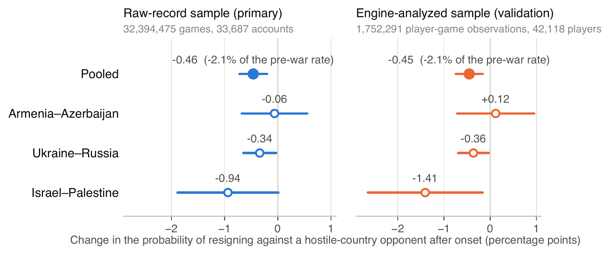

- Per conflict (raw): Ukraine–Russia <math display="inline" xmlns="http://www.w3.org/1998/Math/MathML"><semantics><mrow><mo>−</mo><mn>0.34</mn></mrow></semantics></math> pp (SE 0.16, <math display="inline" xmlns="http://www.w3.org/1998/Math/MathML"><semantics><mrow><mi>p</mi><mo>=</mo><mn>.031</mn></mrow></semantics></math>); Israel–Palestine <math display="inline" xmlns="http://www.w3.org/1998/Math/MathML"><semantics><mrow><mo>−</mo><mn>0.94</mn></mrow></semantics></math> pp (SE 0.48, <math display="inline" xmlns="http://www.w3.org/1998/Math/MathML"><semantics><mrow><mi>p</mi><mo>=</mo><mn>.053</mn></mrow></semantics></math>; 4.9% of its 19.17% baseline); Armenia–Azerbaijan <math display="inline" xmlns="http://www.w3.org/1998/Math/MathML"><semantics><mrow><mo>−</mo><mn>0.06</mn></mrow></semantics></math> pp (SE 0.31, <math display="inline" xmlns="http://www.w3.org/1998/Math/MathML"><semantics><mrow><mi>p</mi><mo>=</mo><mn>.85</mn></mrow></semantics></math>): no change

- Engine-analyzed sample, built under different eligibility rules and sampling: <math display="inline" xmlns="http://www.w3.org/1998/Math/MathML"><semantics><mrow><mo>−</mo><mn>0.45</mn></mrow></semantics></math> pp (SE 0.15, <math display="inline" xmlns="http://www.w3.org/1998/Math/MathML"><semantics><mrow><mi>p</mi><mo>=</mo><mn>.0025</mn></mrow></semantics></math>), 2.1% of its 21.80% baseline; per conflict <math display="inline" xmlns="http://www.w3.org/1998/Math/MathML"><semantics><mrow><mo>−</mo><mn>0.36</mn></mrow></semantics></math> (<math display="inline" xmlns="http://www.w3.org/1998/Math/MathML"><semantics><mrow><mi>p</mi><mo>=</mo><mn>.033</mn></mrow></semantics></math>), <math display="inline" xmlns="http://www.w3.org/1998/Math/MathML"><semantics><mrow><mo>−</mo><mn>1.41</mn></mrow></semantics></math> (<math display="inline" xmlns="http://www.w3.org/1998/Math/MathML"><semantics><mrow><mi>p</mi><mo>=</mo><mn>.027</mn></mrow></semantics></math>), <math display="inline" xmlns="http://www.w3.org/1998/Math/MathML"><semantics><mrow><mo>+</mo><mn>0.12</mn></mrow></semantics></math> (<math display="inline" xmlns="http://www.w3.org/1998/Math/MathML"><semantics><mrow><mi>p</mi><mo>=</mo><mn>.78</mn></mrow></semantics></math>); with each player weighted equally <math display="inline" xmlns="http://www.w3.org/1998/Math/MathML"><semantics><mrow><mo>−</mo><mn>1.13</mn></mrow></semantics></math> pp (SE 0.39, <math display="inline" xmlns="http://www.w3.org/1998/Math/MathML"><semantics><mrow><mi>p</mi><mo>=</mo><mn>.0038</mn></mrow></semantics></math>), about 2.5 times its per-game estimate

- Leave-one-conflict-out: negative throughout; dropping Ukraine–Russia removes 44% of observations and roughly doubles the standard error

.slide-links[

[backup: leave-one-conflict-out](#bk-loo) [back: corroboration](#corroboration)

]

???

Backup: per-conflict estimates in both samples

---

name: bk-composition-full
class: native-slide, with-figure, appendix-slide
count: false

# Backup: all endings, draws, and game length

<!-- David original frame 45 -->

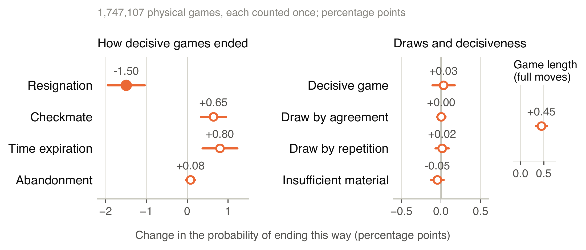

- Each physical game counted once (1,747,107 games): resignation endings <math display="inline" xmlns="http://www.w3.org/1998/Math/MathML"><semantics><mrow><mo>−</mo><mn>1.50</mn></mrow></semantics></math> pp (SE 0.23, <math display="inline" xmlns="http://www.w3.org/1998/Math/MathML"><semantics><mrow><mi>p</mi><mo>&lt;</mo><mn>.0001</mn></mrow></semantics></math>); checkmate <math display="inline" xmlns="http://www.w3.org/1998/Math/MathML"><semantics><mrow><mo>+</mo><mn>0.65</mn></mrow></semantics></math> (SE 0.16, <math display="inline" xmlns="http://www.w3.org/1998/Math/MathML"><semantics><mrow><mi>p</mi><mo>&lt;</mo><mn>.0001</mn></mrow></semantics></math>); time expiration <math display="inline" xmlns="http://www.w3.org/1998/Math/MathML"><semantics><mrow><mo>+</mo><mn>0.80</mn></mrow></semantics></math> (SE 0.22, <math display="inline" xmlns="http://www.w3.org/1998/Math/MathML"><semantics><mrow><mi>p</mi><mo>=</mo><mn>.0002</mn></mrow></semantics></math>); abandonment <math display="inline" xmlns="http://www.w3.org/1998/Math/MathML"><semantics><mrow><mo>+</mo><mn>0.08</mn></mrow></semantics></math> (<math display="inline" xmlns="http://www.w3.org/1998/Math/MathML"><semantics><mrow><mi>p</mi><mo>=</mo><mn>.16</mn></mrow></semantics></math>)

- Decisiveness and every kind of draw unchanged. The two increases sum to <math display="inline" xmlns="http://www.w3.org/1998/Math/MathML"><semantics><mrow><mo>+</mo><mn>1.45</mn></mrow></semantics></math> pp against the <math display="inline" xmlns="http://www.w3.org/1998/Math/MathML"><semantics><mrow><mo>−</mo><mn>1.50</mn></mrow></semantics></math> decline: games that would have ended in concession ran on to checkmate or until a clock ran out

- Games slightly longer (<math display="inline" xmlns="http://www.w3.org/1998/Math/MathML"><semantics><mrow><mo>+</mo><mn>0.449</mn></mrow></semantics></math> moves), a compositional consequence of fewer early concessions. The estimates record where the endings moved, not why

.slide-links[

[backup: game-level estimation](#bk-gamelevel) [back: how games ended](#endings)

]

???

Backup: all endings, draws, and game length

---

name: bk-persistence-full
class: native-slide, with-figure, appendix-slide
count: false

# Backup: all persistence measures

<!-- David original frame 46 -->

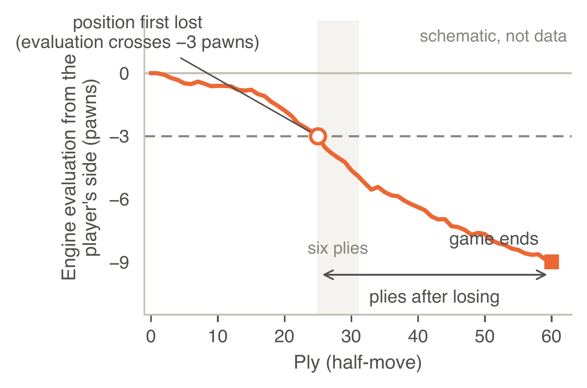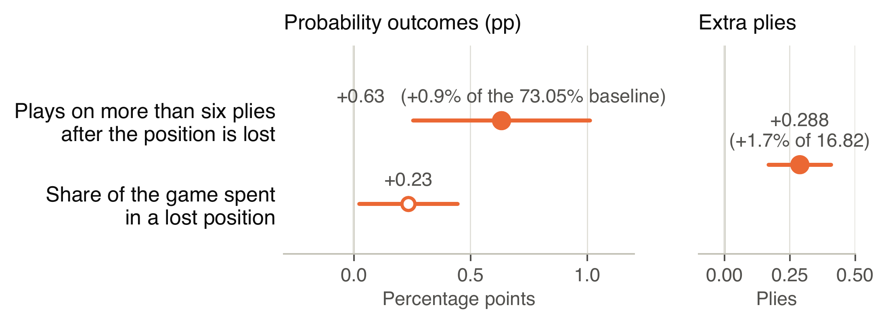

- Risk set: games in which the player’s position ever fell to a disadvantage of three pawns or worse by the engine’s contemporaneous evaluation (almost always decisive); membership never depends on the game’s result. 1,115,113 player-game observations, 35,925 players

- After onset, players played on for <math display="inline" xmlns="http://www.w3.org/1998/Math/MathML"><semantics><mrow><mo>+</mo><mn>0.288</mn></mrow></semantics></math> additional plies per lost game (SE 0.061, <math display="inline" xmlns="http://www.w3.org/1998/Math/MathML"><semantics><mrow><mi>p</mi><mo>&lt;</mo><mn>.0001</mn></mrow></semantics></math>) on a pre-conflict mean of 16.82, a 1.7% increase; more likely to continue beyond six plies, <math display="inline" xmlns="http://www.w3.org/1998/Math/MathML"><semantics><mrow><mo>+</mo><mn>0.63</mn></mrow></semantics></math> pp (SE 0.19, <math display="inline" xmlns="http://www.w3.org/1998/Math/MathML"><semantics><mrow><mi>p</mi><mo>=</mo><mn>.0011</mn></mrow></semantics></math>) on 73.05%; share of the game spent lost <math display="inline" xmlns="http://www.w3.org/1998/Math/MathML"><semantics><mrow><mo>+</mo><mn>0.23</mn></mrow></semantics></math> pp (SE 0.11, <math display="inline" xmlns="http://www.w3.org/1998/Math/MathML"><semantics><mrow><mi>p</mi><mo>=</mo><mn>.030</mn></mrow></semantics></math>)

- The cost falls on the persister: time and effort in positions offering essentially no prospect of reward

.slide-links[

[backup: by conflict](#bk-persistconflict) [FAQ: plies, pawns, centipawns](#faq-glossary) [back: persistence](#persistence)

]

???

Backup: all persistence measures

---

name: bk-quality-full
class: native-slide, with-figure, appendix-slide
count: false

# Backup: three measures of play quality

<!-- David original frame 47 -->

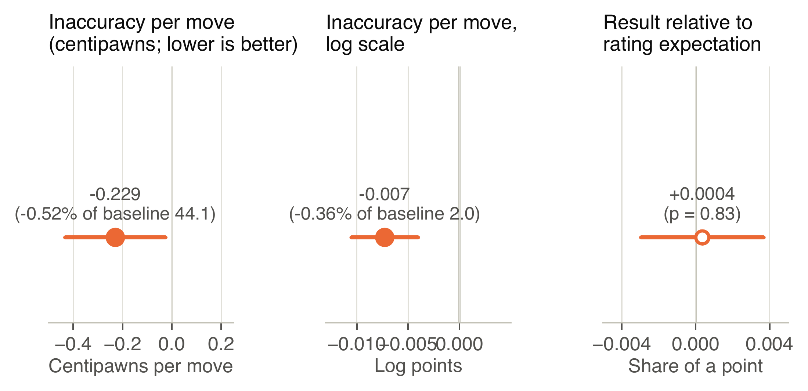

- Average centipawn loss, the engine’s per-move measure of inaccuracy in hundredths of a pawn: <math display="inline" xmlns="http://www.w3.org/1998/Math/MathML"><semantics><mrow><mo>−</mo><mn>0.229</mn></mrow></semantics></math> (SE 0.104, <math display="inline" xmlns="http://www.w3.org/1998/Math/MathML"><semantics><mrow><mi>p</mi><mo>=</mo><mn>.027</mn></mrow></semantics></math>); its log-scaled version <math display="inline" xmlns="http://www.w3.org/1998/Math/MathML"><semantics><mrow><mo>−</mo><mn>0.0073</mn></mrow></semantics></math> (SE 0.0017, <math display="inline" xmlns="http://www.w3.org/1998/Math/MathML"><semantics><mrow><mi>p</mi><mo>&lt;</mo><mn>.001</mn></mrow></semantics></math>)

- Performance relative to the score expected from the rating difference: <math display="inline" xmlns="http://www.w3.org/1998/Math/MathML"><semantics><mrow><mo>+</mo><mn>0.0004</mn></mrow></semantics></math> (<math display="inline" xmlns="http://www.w3.org/1998/Math/MathML"><semantics><mrow><mi>p</mi><mo>=</mo><mn>.83</mn></mrow></semantics></math>)

- This bounds the readings of persistence: whatever kept players in lost positions, it was not accompanied by deteriorating play

.slide-links[

[backup: full quality and secondary outcomes](#bk-secondary) [FAQ: could it be worse play rather than choice?](#faq-worseplay) [back: move quality](#quality)

]

???

Backup: three measures of play quality

---

name: bk-openings-full
class: native-slide, with-figure, appendix-slide
count: false

# Backup: openings by colour, and without Armenia–Azerbaijan

<!-- David original frame 48 -->

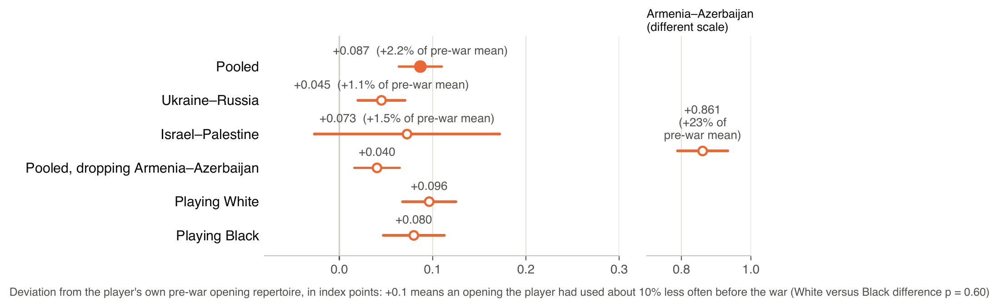

- Each opening is scored against the player’s own repertoire frozen before onset: minus the log of how often they had used it, so <math display="inline" xmlns="http://www.w3.org/1998/Math/MathML"><semantics><mrow><mo>+</mo><mn>0.1</mn></mrow></semantics></math> means an opening used about 10% less often before the war

- Hostile-country games after onset: <math display="inline" xmlns="http://www.w3.org/1998/Math/MathML"><semantics><mrow><mo>+</mo><mn>0.0868</mn></mrow></semantics></math> (SE 0.0117, <math display="inline" xmlns="http://www.w3.org/1998/Math/MathML"><semantics><mrow><mi>p</mi><mo>&lt;</mo><mn>.0001</mn></mrow></semantics></math>), 2.2% of the pre-war mean; White and Black alike (<math display="inline" xmlns="http://www.w3.org/1998/Math/MathML"><semantics><mrow><mi>p</mi><mo>=</mo><mn>.60</mn></mrow></semantics></math>)

- Armenia–Azerbaijan drives much of it (<math display="inline" xmlns="http://www.w3.org/1998/Math/MathML"><semantics><mrow><mo>+</mo><mn>0.861</mn></mrow></semantics></math>); Ukraine–Russia <math display="inline" xmlns="http://www.w3.org/1998/Math/MathML"><semantics><mrow><mo>+</mo><mn>0.045</mn></mrow></semantics></math>; Israel–Palestine <math display="inline" xmlns="http://www.w3.org/1998/Math/MathML"><semantics><mrow><mo>+</mo><mn>0.073</mn></mrow></semantics></math> (<math display="inline" xmlns="http://www.w3.org/1998/Math/MathML"><semantics><mrow><mi>p</mi><mo>=</mo><mn>.15</mn></mrow></semantics></math>); without Armenia–Azerbaijan <math display="inline" xmlns="http://www.w3.org/1998/Math/MathML"><semantics><mrow><mo>+</mo><mn>0.040</mn></mrow></semantics></math> (<math display="inline" xmlns="http://www.w3.org/1998/Math/MathML"><semantics><mrow><mi>p</mi><mo>=</mo><mn>.0011</mn></mrow></semantics></math>)

- Not sharper play: the aggressive-opening share moved <math display="inline" xmlns="http://www.w3.org/1998/Math/MathML"><semantics><mrow><mo>−</mo><mn>0.23</mn></mrow></semantics></math> pp (<math display="inline" xmlns="http://www.w3.org/1998/Math/MathML"><semantics><mrow><mi>p</mi><mo>=</mo><mn>.069</mn></mrow></semantics></math>), the safe-opening share <math display="inline" xmlns="http://www.w3.org/1998/Math/MathML"><semantics><mrow><mo>−</mo><mn>0.04</mn></mrow></semantics></math> pp (<math display="inline" xmlns="http://www.w3.org/1998/Math/MathML"><semantics><mrow><mi>p</mi><mo>=</mo><mn>.82</mn></mrow></semantics></math>)

.slide-links[

[backup: construction of the deviation index](#bk-openings) [backup: opening-style outcomes](#bk-secondary) [back: openings](#openings)

]

???

Backup: openings by colour, and without Armenia–Azerbaijan

---

name: bk-speccurve-full
class: native-slide, with-figure, appendix-slide
count: false

# Backup: the specification curve with the choice matrix

<!-- David original frame 49 -->

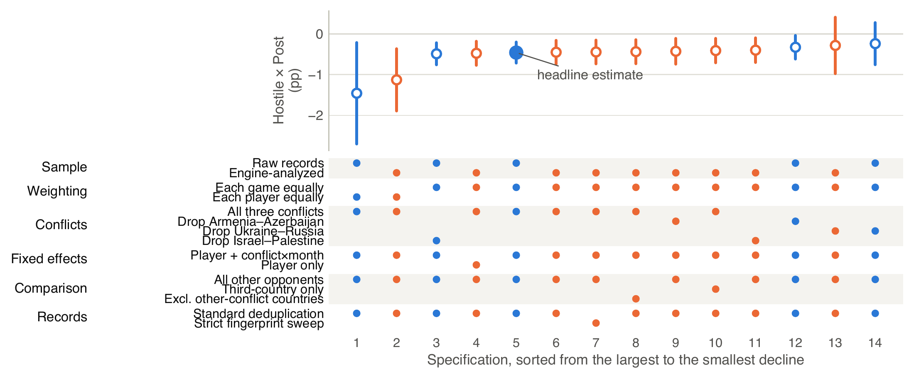

- Fourteen already-reported specifications of the pooled Hostile <math display="inline" xmlns="http://www.w3.org/1998/Math/MathML"><semantics><mo>×</mo></semantics></math> Post estimate; every one negative. The two widest intervals drop Ukraine–Russia, the largest conflict; the two furthest left are the player-weighted estimands

- Stricter deduplication moves the engine estimate from <math display="inline" xmlns="http://www.w3.org/1998/Math/MathML"><semantics><mrow><mo>−</mo><mn>0.453</mn></mrow></semantics></math> to <math display="inline" xmlns="http://www.w3.org/1998/Math/MathML"><semantics><mrow><mo>−</mo><mn>0.447</mn></mrow></semantics></math> pp; player-only fixed effects give <math display="inline" xmlns="http://www.w3.org/1998/Math/MathML"><semantics><mrow><mo>−</mo><mn>0.479</mn></mrow></semantics></math>; comparison-group variants <math display="inline" xmlns="http://www.w3.org/1998/Math/MathML"><semantics><mrow><mo>−</mo><mn>0.41</mn></mrow></semantics></math> and <math display="inline" xmlns="http://www.w3.org/1998/Math/MathML"><semantics><mrow><mo>−</mo><mn>0.44</mn></mrow></semantics></math> pp; clustering by player is the most conservative of four schemes

.slide-links[

[backup: leave-one-out](#bk-loo) [backup: robustness dimensions](#bk-robust) [back: sensitivity](#sensitivity)

]

???

Backup: the specification curve with the choice matrix

---

name: anyone
class: native-slide, with-figure, appendix-slide
count: false

# Backup: is anyone driving it?

<!-- David original frame 50 -->

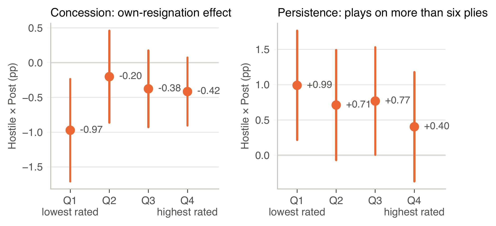 By quartile of pre-onset rating (engine sample); Hostile <math display="inline" xmlns="http://www.w3.org/1998/Math/MathML"><semantics><mo>×</mo></semantics></math> Post in percentage points with 95% intervals.

- Player-level contrasts for the 8,408 players observed in all four design cells: their spread is fully explained by sampling noise (between-player SD of true effects estimated at zero; about 1.9 pp among the 4,263 best-measured players)

- Individual contrasts are noisy (median sampling SE about 27 pp): only the aggregate dispersion is interpretable

- Rating: largest in the lowest-rated quartile (<math display="inline" xmlns="http://www.w3.org/1998/Math/MathML"><semantics><mrow><mo>−</mo><mn>0.97</mn></mrow></semantics></math> pp, <math display="inline" xmlns="http://www.w3.org/1998/Math/MathML"><semantics><mrow><mi>p</mi><mo>=</mo><mn>.010</mn></mrow></semantics></math>), same direction as persistence, but lowest minus highest is not significant (<math display="inline" xmlns="http://www.w3.org/1998/Math/MathML"><semantics><mrow><mi>p</mi><mo>=</mo><mn>.22</mn></mrow></semantics></math>)

- A broad, small shift along the activity margin, not a radical minority

.slide-links[

[backup: dispersion analysis](#bk-dispersion) [backup: rating quartiles](#bk-rating) [FAQ: why no player-level claims?](#faq-heterogeneity) [back: whose average](#whoseaverage)

]

???

Backup: is anyone driving it?

---

name: bk-lit1
class: native-slide, appendix-slide
count: false

# Backup: what we know, conflict and parochialism

<!-- David original frame 51 -->
- People exposed to war become more cohesive within their own group, and their preferences turn parochial, with greater favour toward the in-group rather than greater hostility toward outsiders. The evidence comes from experimental games and surveys among affected populations (Bauer et al. 2016; Bauer, Cassar, Chytilová and Henrich 2014).

- Perceived threat from ethnic outsiders and sectarian conflict shape cooperation and aggression in local settings (Schaub 2017; Silva and Mace 2014).

- Economists have measured the residue of conflict on the sports field. Footballers from countries with a longer history of civil war collect more cards for violent play in European leagues (Miguel, Saiegh and Satyanath 2011). Shared national experiences, such as a national team’s victories, strengthen national identification and reduce violence (Depetris-Chauvin, Durante and Campante 2020).

- The form of contact matters: collaborative contact across caste lines builds cross-group ties, while adversarial contact erodes them (Lowe 2021). External threat can also shift identity, as Russia’s 2014 invasion did for European identification in Ukraine (Gehring 2022).

- Nearly all of this measures attitudes, allocations, or aggregates. Almost none of it observes how an individual treats an identifiable member of the adversary.

.slide-links[

[back: motivation](#motivation)

]

???

Backup: what we know, conflict and parochialism

---

name: bk-lit2
class: native-slide, appendix-slide
count: false

# Backup: what we know, markets, institutions, expression

<!-- David original frame 52 -->
- Interstate tension redirects economic exchange. Firms exposed to the other country lost market value during Sino-Japanese diplomatic shocks (Fisman, Hamao and Wang 2014), and political conflict triggers consumer boycotts that cut trade (Heilmann 2016). Consumption itself expresses identity (Atkin, Colson-Sihra and Shayo 2021).

- Institutional decision-makers show the same pattern: enforcement of foreign claims in Russian courts fell after 2014 (Shchetinin and Avdeev 2026), the closest institutional analogue to the behaviour studied here.

- Online, solidarity and hostility rose on social media around the 2022 invasion of Ukraine (Kyrychenko et al. 2024). Expression, however, is addressed to an audience; a game is played against one particular person, in real time, and only one of them can win.

- Three gaps. The evidence captures generalized preferences rather than behaviour aimed at an identifiable member of the opposing nation. It is collected in or near war zones, where hostility cannot be told apart from direct experience of violence. And it rarely benchmarks behaviour against an objective measure of the situation.

.slide-links[

[back: motivation](#motivation)

]

???

Backup: what we know, markets, institutions, expression

---

name: bk-eligibility
class: native-slide, appendix-slide
count: false

# Backup: eligibility rules for the engine-analyzed sample

<!-- David original frame 53 -->
- A player is eligible with more than 10 games against hostile-country opponents and more than 100 games in total over the combined pre- and post-onset window, after dropping games whose move record was missing

- For each eligible player: every hostile-country game is retained, plus a simple random sample of non-hostile games equal to twice the number of hostile games (or all such games if fewer were available), unstratified by period or game characteristics

- Result: 1,752,291 player-game observations from 42,118 players covering 1,405,530 physical games

- Because eligibility is defined over the full window, it conditions on post-onset play. Participation and attrition are therefore examined in the unrestricted data, and the restricted sample is used only for engine-based outcomes

- The raw-record sample has no such restriction: every available game of each sampled account

- A small number of games failed engine analysis, most likely games of the Chess960 variant, which starts from a randomized position; no failure log was kept

.slide-links[

[back: two samples](#samples)

]

???

Backup: eligibility rules for the engine-analyzed sample

---

name: bk-frame
class: native-slide, appendix-slide
count: false

# Backup: the sampling frame and the probability-sample caveat

<!-- David original frame 54 -->
- The account database was assembled incrementally since 2018: an initial scrape of a broad list of recently active players, expanded by adding every opponent of each player whose game history was collected. This is a snowball frame: the set of known accounts grows through the games of accounts already known

- For each conflict, accounts flagged to the belligerent countries were selected at random from the database, without conditioning on their game histories

- Consequence: neither sample is a probability sample of the platform’s user base, and the paper makes no claims about how common the behaviour is among chess players, let alone the public

- Why the estimand does not need one: the question is whether the same person, facing the same kind of opponent, behaves differently once the countries are at war. A within-person change of that kind is identified without representativeness. Representativeness would matter for a prevalence claim, which is not made

- Chess players are a selected population: people who chose competitive play online. The virtues of the setting (scale, objectivity, distance from the battlefield) are also the bounds of what it can represent

.slide-links[

[back: the records](#records)

]

???

Backup: the sampling frame and the probability-sample caveat

---

name: bk-flags
class: native-slide, appendix-slide, table-slide
count: false

# Backup: flag-stability audit (re-scrape, September 2024)

<!-- David original frame 55 -->
<table><thead><tr class="header"><th style="text-align: left;">Country</th><th style="text-align: right;">Accounts</th><th style="text-align: right;">Any change (%)</th><th style="text-align: right;">Switch rate vs. overall</th><th style="text-align: right;">Net flag-to-flag (%)</th></tr></thead><tbody><tr class="odd"><td style="text-align: left;">All countries</td><td style="text-align: right;">3,602,092</td><td style="text-align: right;">6.03</td><td style="text-align: right;">1.00</td><td style="text-align: right;">0.00</td></tr><tr class="even"><td style="text-align: left;">Armenia</td><td style="text-align: right;">15,679</td><td style="text-align: right;">4.67</td><td style="text-align: right;">0.76</td><td style="text-align: right;"><math display="inline" xmlns="http://www.w3.org/1998/Math/MathML"><semantics><mrow><mo>+</mo><mn>3.08</mn></mrow></semantics></math></td></tr><tr class="odd"><td style="text-align: left;">Azerbaijan</td><td style="text-align: right;">16,812</td><td style="text-align: right;">4.80</td><td style="text-align: right;">0.59</td><td style="text-align: right;"><math display="inline" xmlns="http://www.w3.org/1998/Math/MathML"><semantics><mrow><mo>+</mo><mn>1.15</mn></mrow></semantics></math></td></tr><tr class="even"><td style="text-align: left;">Russia</td><td style="text-align: right;">175,459</td><td style="text-align: right;">8.99</td><td style="text-align: right;">2.12</td><td style="text-align: right;"><math display="inline" xmlns="http://www.w3.org/1998/Math/MathML"><semantics><mrow><mo>−</mo><mn>5.32</mn></mrow></semantics></math></td></tr><tr class="odd"><td style="text-align: left;">Ukraine</td><td style="text-align: right;">53,776</td><td style="text-align: right;">6.09</td><td style="text-align: right;">0.96</td><td style="text-align: right;"><math display="inline" xmlns="http://www.w3.org/1998/Math/MathML"><semantics><mrow><mo>+</mo><mn>0.94</mn></mrow></semantics></math></td></tr><tr class="even"><td style="text-align: left;">Israel</td><td style="text-align: right;">26,674</td><td style="text-align: right;">6.78</td><td style="text-align: right;">1.40</td><td style="text-align: right;"><math display="inline" xmlns="http://www.w3.org/1998/Math/MathML"><semantics><mrow><mo>+</mo><mn>1.19</mn></mrow></semantics></math></td></tr><tr class="odd"><td style="text-align: left;">Palestine</td><td style="text-align: right;">3,477</td><td style="text-align: right;">8.37</td><td style="text-align: right;">1.92</td><td style="text-align: right;"><math display="inline" xmlns="http://www.w3.org/1998/Math/MathML"><semantics><mrow><mo>+</mo><mn>48.35</mn></mrow></semantics></math></td></tr></tbody></table>

- Displayed flags re-scraped in September 2024 against the collection-era baseline: 94.0% of accounts carry the same flag (3,384,894 of 3,602,092)

- Russia and Palestine are the outliers; the Palestinian inflow (of a small base) is an opponent-classification caveat for the Israel–Palestine conflict only

- Misclassification mixes untreated games into the treated set and attenuates the directed estimates toward zero

.slide-links[

[back: flags and selection](#flags)

]

???

Backup: flag-stability audit (re-scrape, September 2024)

---

name: bk-flagmeaning
class: native-slide, appendix-slide
count: false

# Backup: what a displayed flag is, and is not

<!-- David original frame 56 -->
- The flag is the account’s displayed profile country: a self-reported signal, which the user can change at any time. The platform assigns a default at account creation based on location; this platform-policy detail is to be verified against the live page before it enters the manuscript

- Focal players were sampled on their pre-conflict flags, so sampling cannot respond to the war

- A displayed flag is never citizenship, and the two are never equated. Analysis language stays dyad-neutral: “hostile-country opponent” means the displayed-country definition throughout

- Stability: 94.0% of accounts carried the same flag between collection and the September 2024 re-scrape; the exception with teeth is the inflow into the Palestinian flag

- Direction of any error: mixing untreated games into the treated set attenuates the directed estimates toward zero, so misclassification works against finding an effect

.slide-links[

[back: flags and selection](#flags)

]

???

Backup: what a displayed flag is, and is not

---

name: bk-table1
class: native-slide, appendix-slide, table-slide
count: false

# Backup: how Table 1 counts games, observations and accounts

<!-- David original frame 57 -->
- Three counts are reported separately throughout: player-game observations (the regression N), physical games, and focal accounts

- A player-game observation is one focal player’s perspective on one game. Nearly every hostile physical game between two sampled players appears twice, once from each side, so own- and opponent-side coefficients are mechanically linked and are never presented as independent findings

- Physical games are deduplicated on the game’s identifying keys (date, start and end time, opening code, termination). A game whose two players belong to different conflict samples is counted in both per-conflict rows and once in the pooled row, so the per-conflict physical-game column sums above the pooled total

- The pooled sample is dyad-restricted: a focal player enters only through the sample of their own conflict

- Clean game-level quantities (composition of endings, game length) are estimated once per physical game, with the alphabetically first player’s perspective retained as a tie-break: 1,747,107 games, 54,904 retained perspectives

.slide-links[

[back: the three conflicts](#bk-table1-main)

]

???

Backup: how Table 1 counts games, observations and accounts

---

name: bk-2014
class: native-slide, appendix-slide
count: false

# Backup: the Ukraine–Russia 2014 robustness sample

<!-- David original frame 58 -->
- 1,173 accounts; 1,187,263 physical games; 1,276,315 player-game observations; onset 20 February 2014

- Excluded from pooling: a different platform era and data density; used for robustness only

- Own-resignation, raw records: <math display="inline" xmlns="http://www.w3.org/1998/Math/MathML"><semantics><mrow><mo>+</mo><mn>0.18</mn></mrow></semantics></math> pp (SE 0.67, <math display="inline" xmlns="http://www.w3.org/1998/Math/MathML"><semantics><mrow><mi>p</mi><mo>=</mo><mn>.78</mn></mrow></semantics></math>); engine-analyzed sample <math display="inline" xmlns="http://www.w3.org/1998/Math/MathML"><semantics><mrow><mo>−</mo><mn>0.72</mn></mrow></semantics></math> pp (SE 0.79, <math display="inline" xmlns="http://www.w3.org/1998/Math/MathML"><semantics><mrow><mi>p</mi><mo>=</mo><mn>.37</mn></mrow></semantics></math>). Resignation endings of either kind, raw: <math display="inline" xmlns="http://www.w3.org/1998/Math/MathML"><semantics><mrow><mo>−</mo><mn>1.88</mn></mrow></semantics></math> pp (SE 0.77, <math display="inline" xmlns="http://www.w3.org/1998/Math/MathML"><semantics><mrow><mi>p</mi><mo>=</mo><mn>.014</mn></mrow></semantics></math>)

- Persistence: plays on beyond six plies <math display="inline" xmlns="http://www.w3.org/1998/Math/MathML"><semantics><mrow><mo>+</mo><mn>2.38</mn></mrow></semantics></math> pp (SE 1.04, <math display="inline" xmlns="http://www.w3.org/1998/Math/MathML"><semantics><mrow><mi>p</mi><mo>=</mo><mn>.023</mn></mrow></semantics></math>); the largest of the per-conflict persistence estimates

- Openings: deviation from the frozen repertoire <math display="inline" xmlns="http://www.w3.org/1998/Math/MathML"><semantics><mrow><mo>+</mo><mn>0.463</mn></mrow></semantics></math> (SE 0.059, <math display="inline" xmlns="http://www.w3.org/1998/Math/MathML"><semantics><mrow><mi>p</mi><mo>&lt;</mo><mn>.0001</mn></mrow></semantics></math>)

- Limitation, stated wherever the sample appears: the binned pre-onset test for resignation endings of either kind rejects at the 5% level (<math display="inline" xmlns="http://www.w3.org/1998/Math/MathML"><semantics><mrow><mi>p</mi><mo>=</mo><mn>.0197</mn></mrow></semantics></math>); for own-resignation it does not (<math display="inline" xmlns="http://www.w3.org/1998/Math/MathML"><semantics><mrow><mi>p</mi><mo>=</mo><mn>.137</mn></mrow></semantics></math>)

.slide-links[

[back: the three conflicts](#bk-table1-main)

]

???

Backup: the Ukraine–Russia 2014 robustness sample

---

name: bk-robust
class: native-slide, appendix-slide
count: false

# Backup: robustness dimensions tested

<!-- David original frame 59 -->
<table><thead><tr class="header"><th style="text-align: left;">Dimension</th><th style="text-align: left;">What was varied</th><th style="text-align: left;">Pooled own-resignation estimate</th></tr></thead><tbody><tr class="odd"><td style="text-align: left;">Sample</td><td style="text-align: left;">Raw records versus the engine-analyzed sample (independent construction)</td><td style="text-align: left;"><math display="inline" xmlns="http://www.w3.org/1998/Math/MathML"><semantics><mrow><mo>−</mo><mn>0.46</mn></mrow></semantics></math> versus <math display="inline" xmlns="http://www.w3.org/1998/Math/MathML"><semantics><mrow><mo>−</mo><mn>0.45</mn></mrow></semantics></math> pp</td></tr><tr class="even"><td style="text-align: left;">Weighting</td><td style="text-align: left;">Each game versus each player equally</td><td style="text-align: left;"><math display="inline" xmlns="http://www.w3.org/1998/Math/MathML"><semantics><mrow><mo>−</mo><mn>0.46</mn></mrow></semantics></math> versus <math display="inline" xmlns="http://www.w3.org/1998/Math/MathML"><semantics><mrow><mo>−</mo><mn>1.46</mn></mrow></semantics></math> pp (raw); <math display="inline" xmlns="http://www.w3.org/1998/Math/MathML"><semantics><mrow><mo>−</mo><mn>0.45</mn></mrow></semantics></math> versus <math display="inline" xmlns="http://www.w3.org/1998/Math/MathML"><semantics><mrow><mo>−</mo><mn>1.13</mn></mrow></semantics></math> (engine)</td></tr><tr class="odd"><td style="text-align: left;">Conflicts</td><td style="text-align: left;">Leave one conflict out</td><td style="text-align: left;"><math display="inline" xmlns="http://www.w3.org/1998/Math/MathML"><semantics><mrow><mo>−</mo><mn>0.33</mn></mrow></semantics></math> (no AA), <math display="inline" xmlns="http://www.w3.org/1998/Math/MathML"><semantics><mrow><mo>−</mo><mn>0.49</mn></mrow></semantics></math> (no IL–PS), <math display="inline" xmlns="http://www.w3.org/1998/Math/MathML"><semantics><mrow><mo>−</mo><mn>0.24</mn></mrow></semantics></math> pp (no UA–RU; imprecise)</td></tr><tr class="even"><td style="text-align: left;">Fixed effects</td><td style="text-align: left;">Player only, without conflict-by-month effects</td><td style="text-align: left;"><math display="inline" xmlns="http://www.w3.org/1998/Math/MathML"><semantics><mrow><mo>−</mo><mn>0.479</mn></mrow></semantics></math> versus <math display="inline" xmlns="http://www.w3.org/1998/Math/MathML"><semantics><mrow><mo>−</mo><mn>0.453</mn></mrow></semantics></math> pp (engine)</td></tr><tr class="odd"><td style="text-align: left;">Comparison group</td><td style="text-align: left;">Third-country opponents only; excluding other-conflict countries</td><td style="text-align: left;"><math display="inline" xmlns="http://www.w3.org/1998/Math/MathML"><semantics><mrow><mo>−</mo><mn>0.41</mn></mrow></semantics></math> (<math display="inline" xmlns="http://www.w3.org/1998/Math/MathML"><semantics><mrow><mi>p</mi><mo>=</mo><mn>.0072</mn></mrow></semantics></math>); <math display="inline" xmlns="http://www.w3.org/1998/Math/MathML"><semantics><mrow><mo>−</mo><mn>0.44</mn></mrow></semantics></math> pp (<math display="inline" xmlns="http://www.w3.org/1998/Math/MathML"><semantics><mrow><mi>p</mi><mo>=</mo><mn>.0036</mn></mrow></semantics></math>)</td></tr><tr class="even"><td style="text-align: left;">Duplicate records</td><td style="text-align: left;">Strict full-field fingerprint sweep (3,057 rows removed)</td><td style="text-align: left;"><math display="inline" xmlns="http://www.w3.org/1998/Math/MathML"><semantics><mrow><mo>−</mo><mn>0.453</mn></mrow></semantics></math> to <math display="inline" xmlns="http://www.w3.org/1998/Math/MathML"><semantics><mrow><mo>−</mo><mn>0.447</mn></mrow></semantics></math> pp</td></tr><tr class="odd"><td style="text-align: left;">Clustering</td><td style="text-align: left;">Player; physical game; two-way; unordered pair</td><td style="text-align: left;">SE 0.001496 by player is the largest of the four</td></tr><tr class="even"><td style="text-align: left;">Engine-sample repair</td><td style="text-align: left;">Omitted hostile games re-collected for about 30% of engine-sample players</td><td style="text-align: left;">Magnitudes attenuated 1.5–10%; inference unchanged; raw sample unaffected</td></tr><tr class="odd"><td style="text-align: left;">Onset timing</td><td style="text-align: left;">Excluding the partial onset month</td><td style="text-align: left;">Reported in the SI</td></tr></tbody></table>

.slide-links[

[back: sensitivity](#sensitivity)

]

???

Backup: robustness dimensions tested

---

name: bk-gamelevel
class: native-slide, appendix-slide
count: false

# Backup: game-level estimation

<!-- David original frame 60 -->
- Composition outcomes (how games ended, game length) are estimated once per physical game, which removes the mechanical duplication of player-game rows

- Where both players of a game were sampled, the alphabetically first player’s perspective is retained as a tie-break: 1,747,107 games with 54,904 retained perspectives

- The specification keeps sample-by-month effects and both players’ ratings but no player effects (a game no longer belongs to one focal player), and clusters standard errors on the retained perspective

- Outcomes: endings by resignation, checkmate, time expiration, abandonment; decisiveness; the three draw types; and game length in full moves

- These estimates complement, and are never independent of, the directed results: a directed own-resignation and its mirror, opponent-resignation, are two sides of the same physical game

.slide-links[

[back: how games ended](#endings)

]

???

Backup: game-level estimation

---

name: bk-monthly
class: native-slide, with-figure, appendix-slide
count: false

# Backup: monthly event study, raw-record sample

<!-- David original frame 61 -->

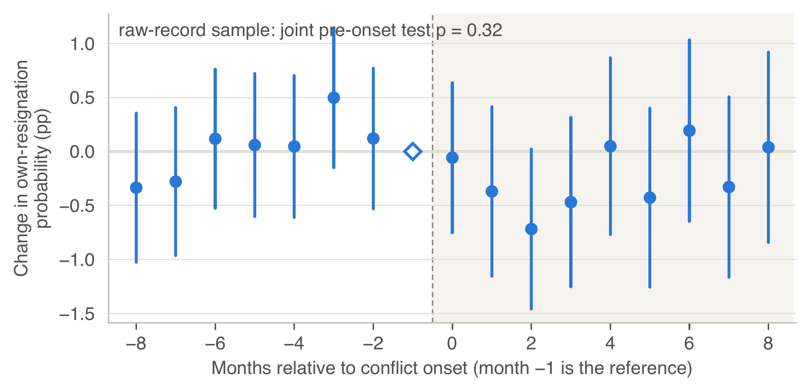

Months <math display="inline" xmlns="http://www.w3.org/1998/Math/MathML"><semantics><mrow><mo>−</mo><mn>8</mn></mrow></semantics></math> to <math display="inline" xmlns="http://www.w3.org/1998/Math/MathML"><semantics><mrow><mo>+</mo><mn>8</mn></mrow></semantics></math> around onset; player and sample-by-month effects; the joint chi-squared test on all pre-onset leads gives <math display="inline" xmlns="http://www.w3.org/1998/Math/MathML"><semantics><mrow><mi>p</mi><mo>=</mo><mn>.320</mn></mrow></semantics></math>.

.slide-links[

[back: before onset](#before)

]

???

Backup: monthly event study, raw-record sample

---

name: david-62
class: native-slide, with-figure, appendix-slide
count: false

# Backup: monthly event study, engine-analyzed sample

<!-- David original frame 62 -->

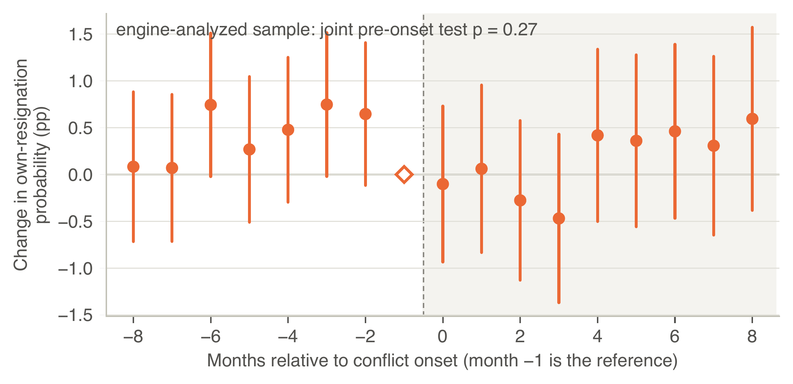

Same specification on the engine-analyzed sample; the joint pre-onset test gives <math display="inline" xmlns="http://www.w3.org/1998/Math/MathML"><semantics><mrow><mi>p</mi><mo>=</mo><mn>.266</mn></mrow></semantics></math>.

.slide-links[

[back: before onset](#before)

]

???

Backup: monthly event study, engine-analyzed sample

---

name: bk-fullwindow
class: native-slide, with-figure, appendix-slide
count: false

# Backup: three-month bins to month 17

<!-- David original frame 63 -->

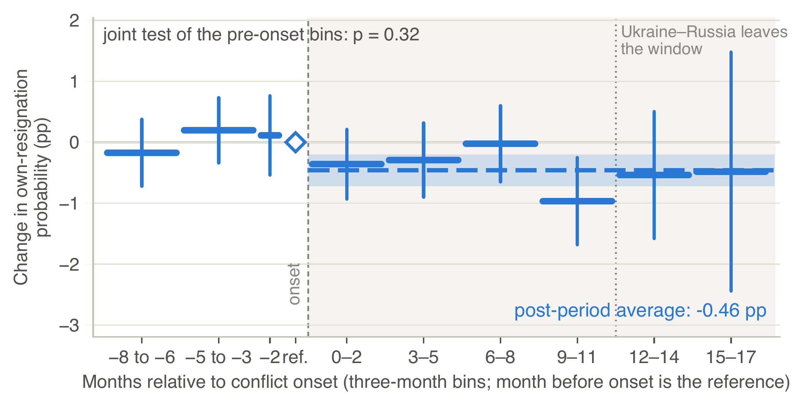

The bins for months 12–14 (<math display="inline" xmlns="http://www.w3.org/1998/Math/MathML"><semantics><mrow><mo>−</mo><mn>0.54</mn></mrow></semantics></math> pp) and 15–17 (<math display="inline" xmlns="http://www.w3.org/1998/Math/MathML"><semantics><mrow><mo>−</mo><mn>0.48</mn></mrow></semantics></math> pp) are negative but imprecise. Ukraine–Russia, the largest sample, exits the window after month 11, so these bins rest on the remaining conflicts alone, and even the 9–11 bin draws on fewer Ukraine–Russia months.

.slide-links[

[back: after onset](#after)

]

???

Backup: three-month bins to month 17

---

name: bk-pretrends
class: native-slide, appendix-slide, table-slide
count: false

# Backup: joint pre-onset tests by conflict

<!-- David original frame 64 -->
<table><thead><tr class="header"><th style="text-align: left;">Own-resignation</th><th style="text-align: right;">Raw, binned</th><th style="text-align: right;">Raw, monthly</th><th style="text-align: right;">Engine, monthly</th></tr></thead><tbody><tr class="odd"><td style="text-align: left;">Pooled</td><td style="text-align: right;">.316</td><td style="text-align: right;">.320</td><td style="text-align: right;">.266</td></tr><tr class="even"><td style="text-align: left;">Armenia–Azerbaijan</td><td style="text-align: right;">.825</td><td style="text-align: right;">.613</td><td style="text-align: right;">.685</td></tr><tr class="odd"><td style="text-align: left;">Ukraine–Russia 2022</td><td style="text-align: right;">.332</td><td style="text-align: right;">.353</td><td style="text-align: right;">.305</td></tr><tr class="even"><td style="text-align: left;">Israel–Palestine</td><td style="text-align: right;">.378</td><td style="text-align: right;">.504</td><td style="text-align: right;">.452</td></tr><tr class="odd"><td style="text-align: left;">Ukraine–Russia 2014</td><td style="text-align: right;">.137</td><td style="text-align: right;">.381</td><td style="text-align: right;">.038</td></tr></tbody></table>

- <math display="inline" xmlns="http://www.w3.org/1998/Math/MathML"><semantics><mi>p</mi></semantics></math>-values of the joint chi-squared test on all pre-onset coefficients (month <math display="inline" xmlns="http://www.w3.org/1998/Math/MathML"><semantics><mrow><mo>−</mo><mn>1</mn></mrow></semantics></math> omitted)

- No test rejects at the 5% level in the three pooled conflicts. The 2014 robustness sample rejects in the engine monthly version, and its binned test for resignation endings of either kind rejects (<math display="inline" xmlns="http://www.w3.org/1998/Math/MathML"><semantics><mrow><mi>p</mi><mo>=</mo><mn>.0197</mn></mrow></semantics></math>); this limitation is noted wherever that sample appears

.slide-links[

[back: before onset](#before)

]

???

Backup: joint pre-onset tests by conflict

---

name: bk-contact
class: native-slide, with-figure, appendix-slide
count: false

# Backup: Ukraine–Russia, contact with the other side month by month

<!-- David original frame 65 -->

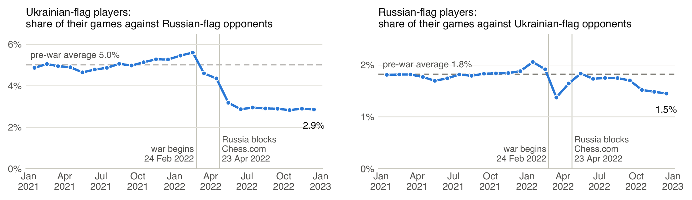

- No drop at onset. The Ukrainian-side share steps down in May, the first full month after Russia blocked the platform; the Russian-side share dips in March and is back at its pre-war level from May to September

- A game left before the first move vanishes from both players’ records, so avoidance would lower both series together. They move apart, which points to the supply of opponents; avoidance cannot be excluded

Monthly counts from the full raw records (first results, not yet in the paper).

.slide-links[

[FAQ: quit on seeing the flag?](#faq-quit) [FAQ: can players avoid opponents?](#faq-avoid) [back: limitations](#flags)

]

???

Backup: Ukraine–Russia, contact with the other side month by month

---

name: bk-persistconflict
class: native-slide, with-figure, appendix-slide
count: false

# Backup: persistence by conflict

<!-- David original frame 66 -->

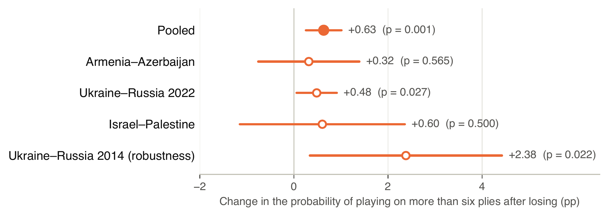

Probability of continuing more than six plies after the position first became lost; player and conflict-by-month effects; 95% confidence intervals. Positive in all four samples and statistically powered in the largest.

.slide-links[

[back: checks](#checks)

]

???

Backup: persistence by conflict

---

name: bk-secondary
class: native-slide, appendix-slide, table-slide
count: false

# Backup: play-quality and secondary outcomes (engine-analyzed sample, pooled)

<!-- David original frame 67 -->
<table><thead><tr class="header"><th style="text-align: left;">Outcome</th><th style="text-align: right;">Estimate</th><th style="text-align: right;">SE</th><th style="text-align: right;"><math display="inline" xmlns="http://www.w3.org/1998/Math/MathML"><semantics><mi>p</mi></semantics></math></th></tr></thead><tbody><tr class="odd"><td style="text-align: left;">Average centipawn loss (centipawns)</td><td style="text-align: right;"><math display="inline" xmlns="http://www.w3.org/1998/Math/MathML"><semantics><mrow><mo>−</mo><mn>0.229</mn></mrow></semantics></math></td><td style="text-align: right;">0.104</td><td style="text-align: right;">.027</td></tr><tr class="even"><td style="text-align: left;">Average log centipawn loss (log points)</td><td style="text-align: right;"><math display="inline" xmlns="http://www.w3.org/1998/Math/MathML"><semantics><mrow><mo>−</mo><mn>0.0073</mn></mrow></semantics></math></td><td style="text-align: right;">0.0017</td><td style="text-align: right;"><math display="inline" xmlns="http://www.w3.org/1998/Math/MathML"><semantics><mrow><mo>&lt;</mo><mn>.001</mn></mrow></semantics></math></td></tr><tr class="odd"><td style="text-align: left;">Overperformance vs. rating expectation (score share)</td><td style="text-align: right;"><math display="inline" xmlns="http://www.w3.org/1998/Math/MathML"><semantics><mrow><mo>+</mo><mn>0.0004</mn></mrow></semantics></math></td><td style="text-align: right;">0.0017</td><td style="text-align: right;">.83</td></tr><tr class="even"><td style="text-align: left;">Aggressive opening (pp)</td><td style="text-align: right;"><math display="inline" xmlns="http://www.w3.org/1998/Math/MathML"><semantics><mrow><mo>−</mo><mn>0.23</mn></mrow></semantics></math></td><td style="text-align: right;">0.12</td><td style="text-align: right;">.069</td></tr><tr class="odd"><td style="text-align: left;">Safe opening (pp)</td><td style="text-align: right;"><math display="inline" xmlns="http://www.w3.org/1998/Math/MathML"><semantics><mrow><mo>−</mo><mn>0.04</mn></mrow></semantics></math></td><td style="text-align: right;">0.18</td><td style="text-align: right;">.82</td></tr><tr class="even"><td style="text-align: left;">Ended on time (pp)</td><td style="text-align: right;"><math display="inline" xmlns="http://www.w3.org/1998/Math/MathML"><semantics><mrow><mo>+</mo><mn>0.23</mn></mrow></semantics></math></td><td style="text-align: right;">0.17</td><td style="text-align: right;">.16</td></tr><tr class="odd"><td style="text-align: left;">Draw by repetition (pp)</td><td style="text-align: right;"><math display="inline" xmlns="http://www.w3.org/1998/Math/MathML"><semantics><mrow><mo>+</mo><mn>0.10</mn></mrow></semantics></math></td><td style="text-align: right;">0.05</td><td style="text-align: right;">.046</td></tr><tr class="even"><td style="text-align: left;">Draw by agreement (pp)</td><td style="text-align: right;"><math display="inline" xmlns="http://www.w3.org/1998/Math/MathML"><semantics><mrow><mo>+</mo><mn>0.02</mn></mrow></semantics></math></td><td style="text-align: right;">0.03</td><td style="text-align: right;">.48</td></tr><tr class="odd"><td style="text-align: left;">Insufficient material (pp)</td><td style="text-align: right;"><math display="inline" xmlns="http://www.w3.org/1998/Math/MathML"><semantics><mrow><mo>+</mo><mn>0.04</mn></mrow></semantics></math></td><td style="text-align: right;">0.05</td><td style="text-align: right;">.45</td></tr><tr class="even"><td style="text-align: left;">Abandonment (pp)</td><td style="text-align: right;"><math display="inline" xmlns="http://www.w3.org/1998/Math/MathML"><semantics><mrow><mo>+</mo><mn>0.09</mn></mrow></semantics></math></td><td style="text-align: right;">0.06</td><td style="text-align: right;">.10</td></tr><tr class="odd"><td style="text-align: left;">Stalling (pp)</td><td style="text-align: right;"><math display="inline" xmlns="http://www.w3.org/1998/Math/MathML"><semantics><mrow><mo>+</mo><mn>0.06</mn></mrow></semantics></math></td><td style="text-align: right;">0.07</td><td style="text-align: right;">.36</td></tr></tbody></table>

Hostile <math display="inline" xmlns="http://www.w3.org/1998/Math/MathML"><semantics><mo>×</mo></semantics></math> Post; player-game observations; player and conflict-by-month effects; clustered by player.

.slide-links[

[back: move quality](#quality)

]

???

Backup: play-quality and secondary outcomes (engine-analyzed sample, pooled)

---

name: bk-openings
class: native-slide, appendix-slide
count: false

# Backup: the repertoire-deviation index

<!-- David original frame 68 -->
- The opening is the first phase of a game, when players choose among well-known sequences of moves; most settle on a small set of favourites (their repertoire) and reach for it by habit

- Each game’s opening is scored against the player’s own pre-conflict repertoire: the repertoire is frozen before onset and scored out of sample within the pre-period, with smoothing applied evenly across openings

- Higher values mean the game’s opening was rarer in that player’s own pre-war play; the index measures deviation from habit, not preparation and not identity

- Freezing the repertoire before onset matters: scoring each game against a whole-period repertoire would let post-onset games partly define their own familiarity

- Symmetry across colours (White <math display="inline" xmlns="http://www.w3.org/1998/Math/MathML"><semantics><mrow><mo>+</mo><mn>0.096</mn></mrow></semantics></math>, Black <math display="inline" xmlns="http://www.w3.org/1998/Math/MathML"><semantics><mrow><mo>+</mo><mn>0.080</mn></mrow></semantics></math>, difference <math display="inline" xmlns="http://www.w3.org/1998/Math/MathML"><semantics><mrow><mi>p</mi><mo>=</mo><mn>.60</mn></mrow></semantics></math>) rules out an artifact of White choosing the opening

- Scoring variants are reported in the SI

.slide-links[

[back: openings](#openings)

]

???

Backup: the repertoire-deviation index

---

name: bk-aalength
class: native-slide, appendix-slide
count: false

# Backup: game length in Armenia–Azerbaijan

<!-- David original frame 69 -->
- Before the war, hostile-country games in this dyad were already longer than the same players’ other games: mean length 37.43 moves versus 35.12 (raw-record sample, pre-onset)

- Game length after onset (Hostile <math display="inline" xmlns="http://www.w3.org/1998/Math/MathML"><semantics><mo>×</mo></semantics></math> Post, engine-analyzed sample, full moves):

<table><thead><tr class="header"><th style="text-align: left;">Group</th><th style="text-align: right;">Estimate</th><th style="text-align: right;">SE</th><th style="text-align: right;"><math display="inline" xmlns="http://www.w3.org/1998/Math/MathML"><semantics><mi>p</mi></semantics></math></th></tr></thead><tbody><tr class="odd"><td style="text-align: left;">Pooled</td><td style="text-align: right;"><math display="inline" xmlns="http://www.w3.org/1998/Math/MathML"><semantics><mrow><mo>+</mo><mn>0.437</mn></mrow></semantics></math></td><td style="text-align: right;">0.055</td><td style="text-align: right;"><math display="inline" xmlns="http://www.w3.org/1998/Math/MathML"><semantics><mrow><mo>&lt;</mo><mn>.0001</mn></mrow></semantics></math></td></tr><tr class="even"><td style="text-align: left;">Armenia–Azerbaijan</td><td style="text-align: right;"><math display="inline" xmlns="http://www.w3.org/1998/Math/MathML"><semantics><mrow><mo>+</mo><mn>0.527</mn></mrow></semantics></math></td><td style="text-align: right;">0.168</td><td style="text-align: right;">.0018</td></tr><tr class="odd"><td style="text-align: left;">Ukraine–Russia 2022</td><td style="text-align: right;"><math display="inline" xmlns="http://www.w3.org/1998/Math/MathML"><semantics><mrow><mo>+</mo><mn>0.225</mn></mrow></semantics></math></td><td style="text-align: right;">0.061</td><td style="text-align: right;">.0003</td></tr><tr class="even"><td style="text-align: left;">Israel–Palestine</td><td style="text-align: right;"><math display="inline" xmlns="http://www.w3.org/1998/Math/MathML"><semantics><mrow><mo>+</mo><mn>0.564</mn></mrow></semantics></math></td><td style="text-align: right;">0.236</td><td style="text-align: right;">.017</td></tr></tbody></table>

- Game length is a secondary compositional consequence of fewer early concessions, not a separate finding; the pre-existing gap in this dyad is stated alongside the null on resignation

.slide-links[

[back: the boundary](#boundary)

]

???

Backup: game length in Armenia–Azerbaijan

---

name: bk-dispersion
class: native-slide, appendix-slide, table-slide
count: false

# Backup: dispersion of player-level effects

<!-- David original frame 70 -->
<table><thead><tr class="header"><th style="text-align: left;">Players included</th><th style="text-align: right;">N</th><th style="text-align: right;">Weighted mean</th><th style="text-align: right;">SD of true effects</th><th style="text-align: right;">Dispersion test</th></tr></thead><tbody><tr class="odd"><td style="text-align: left;">All four design cells occupied</td><td style="text-align: right;">8,408</td><td style="text-align: right;"><math display="inline" xmlns="http://www.w3.org/1998/Math/MathML"><semantics><mrow><mo>−</mo><mn>0.56</mn></mrow></semantics></math> pp</td><td style="text-align: right;">0.0 pp</td><td style="text-align: right;"><math display="inline" xmlns="http://www.w3.org/1998/Math/MathML"><semantics><mrow><mi>Q</mi><mo>=</mo><mn>8</mn><mo>,</mo><mn>328</mn></mrow></semantics></math> on 8,407 df</td></tr><tr class="even"><td style="text-align: left;">At least five games per cell</td><td style="text-align: right;">4,263</td><td style="text-align: right;"><math display="inline" xmlns="http://www.w3.org/1998/Math/MathML"><semantics><mrow><mo>−</mo><mn>0.51</mn></mrow></semantics></math> pp</td><td style="text-align: right;">1.9 pp</td><td style="text-align: right;"><math display="inline" xmlns="http://www.w3.org/1998/Math/MathML"><semantics><mrow><mi>Q</mi><mo>=</mo><mn>4</mn><mo>,</mo><mn>450</mn></mrow></semantics></math> on 4,262 df</td></tr></tbody></table>

- Each player’s own difference-in-differences contrast on own-resignation, with a binomial sampling variance smoothed so that empty cells do not yield zero variance; an empirical-Bayes layer tests whether the spread exceeds what sampling variances alone would produce (DerSimonian–Laird)

- In the full set, the observed spread is fully explained by sampling noise; in the better-measured half, the estimated spread of true effects is about 1.9 pp around a mean of about <math display="inline" xmlns="http://www.w3.org/1998/Math/MathML"><semantics><mrow><mo>−</mo><mn>0.5</mn></mrow></semantics></math> pp

- The per-player contrasts net out player-level time shifts through the player’s own other games but do not impose the headline specification’s conflict-by-month effects; the analysis is descriptive

- The four-cell requirement selects the most active players; less active players are unmeasurable at the player level by construction

.slide-links[

[back: whose average](#whoseaverage)

]

???

Backup: dispersion of player-level effects

---

name: bk-rating
class: native-slide, with-figure, appendix-slide
count: false

# Backup: rating quartiles, concession and persistence

<!-- David original frame 71 -->

Players assigned to quartiles of pre-onset mean rating within their conflict sample; headline specification by quartile. Concession: lowest minus highest <math display="inline" xmlns="http://www.w3.org/1998/Math/MathML"><semantics><mrow><mo>−</mo><mn>0.56</mn></mrow></semantics></math> pp (<math display="inline" xmlns="http://www.w3.org/1998/Math/MathML"><semantics><mrow><mi>p</mi><mo>=</mo><mn>.22</mn></mrow></semantics></math>). Both gradients point the same way but neither cross-quartile difference is significant; descriptive only.

.slide-links[

[back: whose average](#whoseaverage)

]

???

Backup: rating quartiles, concession and persistence

---

name: bk-activity
class: native-slide, appendix-slide, table-slide
count: false

# Backup: activity quartiles and the pooled trend test

<!-- David original frame 72 -->
<table><thead><tr class="header"><th style="text-align: left;">Quartile (pre-onset hostile games)</th><th style="text-align: right;">Estimate (pp)</th><th style="text-align: right;">SE</th><th style="text-align: right;"><math display="inline" xmlns="http://www.w3.org/1998/Math/MathML"><semantics><mi>p</mi></semantics></math></th><th style="text-align: right;">Players</th><th style="text-align: right;">Rel. to baseline</th></tr></thead><tbody><tr class="odd"><td style="text-align: left;">Q1 least active</td><td style="text-align: right;"><math display="inline" xmlns="http://www.w3.org/1998/Math/MathML"><semantics><mrow><mo>−</mo><mn>1.73</mn></mrow></semantics></math></td><td style="text-align: right;">1.36</td><td style="text-align: right;">.20</td><td style="text-align: right;">3,753</td><td style="text-align: right;"><math display="inline" xmlns="http://www.w3.org/1998/Math/MathML"><semantics><mrow><mo>−</mo><mn>7.2</mn><mi>%</mi></mrow></semantics></math></td></tr><tr class="even"><td style="text-align: left;">Q2</td><td style="text-align: right;"><math display="inline" xmlns="http://www.w3.org/1998/Math/MathML"><semantics><mrow><mo>−</mo><mn>1.18</mn></mrow></semantics></math></td><td style="text-align: right;">0.88</td><td style="text-align: right;">.18</td><td style="text-align: right;">11,323</td><td style="text-align: right;"><math display="inline" xmlns="http://www.w3.org/1998/Math/MathML"><semantics><mrow><mo>−</mo><mn>5.0</mn><mi>%</mi></mrow></semantics></math></td></tr><tr class="odd"><td style="text-align: left;">Q3</td><td style="text-align: right;"><math display="inline" xmlns="http://www.w3.org/1998/Math/MathML"><semantics><mrow><mo>−</mo><mn>0.57</mn></mrow></semantics></math></td><td style="text-align: right;">0.47</td><td style="text-align: right;">.23</td><td style="text-align: right;">11,833</td><td style="text-align: right;"><math display="inline" xmlns="http://www.w3.org/1998/Math/MathML"><semantics><mrow><mo>−</mo><mn>2.4</mn><mi>%</mi></mrow></semantics></math></td></tr><tr class="even"><td style="text-align: left;">Q4 most active</td><td style="text-align: right;"><math display="inline" xmlns="http://www.w3.org/1998/Math/MathML"><semantics><mrow><mo>−</mo><mn>0.35</mn></mrow></semantics></math></td><td style="text-align: right;">0.17</td><td style="text-align: right;">.035</td><td style="text-align: right;">11,834</td><td style="text-align: right;"><math display="inline" xmlns="http://www.w3.org/1998/Math/MathML"><semantics><mrow><mo>−</mo><mn>1.6</mn><mi>%</mi></mrow></semantics></math></td></tr></tbody></table>

- Q1 minus Q4: <math display="inline" xmlns="http://www.w3.org/1998/Math/MathML"><semantics><mrow><mo>−</mo><mn>1.38</mn></mrow></semantics></math> pp (<math display="inline" xmlns="http://www.w3.org/1998/Math/MathML"><semantics><mrow><mi>p</mi><mo>=</mo><mn>.31</mn></mrow></semantics></math>); the least active quartile carries the least data by construction

- Pooled interaction of Hostile <math display="inline" xmlns="http://www.w3.org/1998/Math/MathML"><semantics><mo>×</mo></semantics></math> Post with standardized log activity: <math display="inline" xmlns="http://www.w3.org/1998/Math/MathML"><semantics><mrow><mo>+</mo><mn>0.06</mn></mrow></semantics></math> pp per SD (<math display="inline" xmlns="http://www.w3.org/1998/Math/MathML"><semantics><mrow><mi>p</mi><mo>=</mo><mn>.58</mn></mrow></semantics></math>); that regression is game-weighted, so it is dominated by the active players it is trying to contrast

- Even the least active players clear the engine sample’s eligibility floor of more than 10 hostile-country games, so the range is compressed

.slide-links[

[back: whose average](#whoseaverage)

]

???

Backup: activity quartiles and the pooled trend test

---

name: bk-loo
class: native-slide, with-figure, appendix-slide
count: false

# Backup: leave-one-conflict-out

<!-- David original frame 73 -->

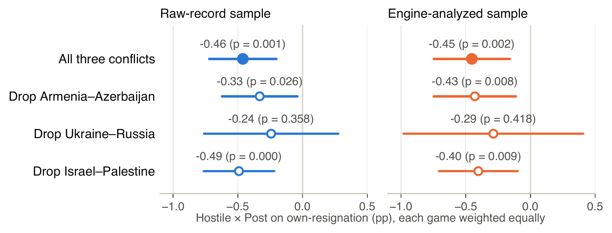

Raw records: without Armenia–Azerbaijan <math display="inline" xmlns="http://www.w3.org/1998/Math/MathML"><semantics><mrow><mo>−</mo><mn>0.33</mn></mrow></semantics></math> pp (SE 0.15); without Israel–Palestine <math display="inline" xmlns="http://www.w3.org/1998/Math/MathML"><semantics><mrow><mo>−</mo><mn>0.49</mn></mrow></semantics></math> pp (SE 0.14); without Ukraine–Russia <math display="inline" xmlns="http://www.w3.org/1998/Math/MathML"><semantics><mrow><mo>−</mo><mn>0.24</mn></mrow></semantics></math> pp (95% CI <math display="inline" xmlns="http://www.w3.org/1998/Math/MathML"><semantics><mrow><mo>−</mo><mn>0.76</mn></mrow></semantics></math> to <math display="inline" xmlns="http://www.w3.org/1998/Math/MathML"><semantics><mrow><mo>+</mo><mn>0.28</mn></mrow></semantics></math>), consistent with both the pooled estimate and zero. Excluding Ukraine–Russia removes 44% of observations (35.9M to 20.3M); its own per-conflict estimate is independently negative (<math display="inline" xmlns="http://www.w3.org/1998/Math/MathML"><semantics><mrow><mo>−</mo><mn>0.34</mn></mrow></semantics></math> pp, <math display="inline" xmlns="http://www.w3.org/1998/Math/MathML"><semantics><mrow><mi>p</mi><mo>=</mo><mn>.031</mn></mrow></semantics></math>).

.slide-links[

[back: by conflict](#byconflict)

]

???

Backup: leave-one-conflict-out

---

name: bk-ethics
class: native-slide, appendix-slide
count: false

# Backup: ethics and data governance

<!-- David original frame 74 -->
- All data derive from publicly available game records, analyzed at scale with de-identified accounts; no interaction with players and no manipulation

- Account names are pseudonymized in the replication release; no cross-linking to off-platform identity was attempted

- Displayed country is an inferred, self-reported signal; analysis language remains dyad-neutral, and nationality or citizenship is never asserted

- Approved by the University of Queensland Human Research Ethics Committee (approval 2026/HE011640)

- Replication code and outputs released at a tagged commit of the project repository; data deposit via the University of Queensland Research Data Manager; the archive may include the raw game records, whose redistribution the platform permits

.slide-links[

[back: backup index](#backup-index)

]

???

Backup: ethics and data governance

---

name: bk-iran
class: native-slide, appendix-slide
count: false

# Backup: Iran feasibility

<!-- David original frame 75 -->
- Onset: February 2026. The September 2024 account re-scrape predates it, so focal players can be sampled on pre-conflict flags, as the design requires

- Pool size: about 44,000 Iranian-flagged accounts in the re-scrape, roughly three times the Armenian pool, with no shortage on the other side

- The specification (exact onset, dyad restriction, player and conflict-by-month effects, both weightings) was frozen months before any Iranian data were examined; a timestamped pre-analysis plan turns the run into a preregistered out-of-sample replication

- Trade-off: running now bakes in whatever a short post-onset window shows, including possibly a noisy null; waiting lengthens the window

.source-note[

Pool counts from the coauthors’ September 2024 re-scrape; not part of the frozen manuscript outputs.

]

.slide-links[

[back: next steps](#nextsteps)

]

???

Backup: Iran feasibility

---

name: faq-index
class: native-slide, appendix-slide, faq-slide, index-slide
count: false

# FAQ

<!-- David original frame 76 -->
<ol><li>
<a href="#faq-lpm">Why a linear probability model and not a logit?</a>
</li><li>
<a href="#faq-magnitude">What do <math display="inline" xmlns="http://www.w3.org/1998/Math/MathML"><semantics><mrow><mo>−</mo><mn>1.46</mn></mrow></semantics></math> and <math display="inline" xmlns="http://www.w3.org/1998/Math/MathML"><semantics><mrow><mo>−</mo><mn>0.46</mn></mrow></semantics></math> percentage points mean concretely?</a>
</li><li>
<a href="#faq-weighting">Why does weighting players equally triple the estimate?</a>
</li><li>
<a href="#faq-exogenous">What exactly is exogenous here, and what is not?</a>
</li><li>
<a href="#faq-flags">Are flags citizenship?</a>
</li><li>
<a href="#faq-aa">Why is Armenia–Azerbaijan null?</a>
</li><li>
<a href="#faq-heterogeneity">Why does the paper not claim individual-level heterogeneity?</a>
</li><li>
<a href="#faq-worseplay">Could the effect be worse play rather than a choice?</a>
</li><li>
<a href="#faq-independent">Why do the two samples count as independent corroboration?</a>
</li><li>
<a href="#faq-conflicts">Why these three conflicts?</a>
</li><li>
<a href="#faq-avoid">Can players avoid hostile-country opponents?</a>
</li><li>
<a href="#faq-structural">Is there a structural model behind this?</a>
</li><li>
<a href="#faq-glossary">Glossary: plies, pawns, centipawns, ratings, time controls</a>
</li><li>
<a href="#faq-quit">Could players simply have quit on seeing the flag?</a>
</li><li>
<a href="#faq-pretrends">Why should the pre-onset estimates be zero?</a>
</li></ol>

.slide-links[

[backup index](#backup-index)

]

???

FAQ

---

name: faq-lpm
class: native-slide, appendix-slide, faq-slide
count: false

# FAQ: why a linear probability model and not a logit?

<!-- David original frame 77 -->
The outcome is binary (the focal player resigned, or did not), so a logit is the natural alternative. We estimate a linear probability model for two reasons.

First, interpretability. The coefficient <math display="inline" xmlns="http://www.w3.org/1998/Math/MathML"><semantics><mi>β</mi></semantics></math> is directly the change in the probability of resigning, in percentage points, which is the unit the whole paper reports and the unit in which the two weightings (per game and per player) can be compared without further transformation.

Second, tractability. The raw-record sample has 36 million rows with player fixed effects and conflict-by-month effects. A fixed-effects logit at that scale was not run, and with tens of thousands of player effects the nonlinear estimator also faces the incidental-parameters problem.

The usual objection to the linear model is that fitted probabilities can leave the unit interval. Here that has little bite. The pre-onset resignation rates sit near 0.19 to 0.22, and the estimated effects are fractions of a percentage point. For example, take a player who resigns 21% of hostile-country games before the war. A decline of half a percentage point moves that to about 20.5%, nowhere near a boundary. The relative effects the paper reports (about 2% of the baseline per game, about 7% for the typical player) are plain ratios of the estimate to the baseline rate; a logit would report odds ratios, a different quantity, and none was estimated.

.slide-links[

[back: estimating equation](#equation)

]

???

FAQ: why a linear probability model and not a logit?

---

name: faq-magnitude
class: native-slide, appendix-slide, faq-slide
count: false

# FAQ: what do <math display="inline" xmlns="http://www.w3.org/1998/Math/MathML"><semantics><mrow><mo>−</mo><mn>1.46</mn></mrow></semantics></math> and <math display="inline" xmlns="http://www.w3.org/1998/Math/MathML"><semantics><mrow><mo>−</mo><mn>0.46</mn></mrow></semantics></math> percentage points mean concretely?

<!-- David original frame 78 -->
Before onset, players resigned 21.46% of their games against hostile-country opponents. Weighting each player equally, the typical player resigned 1.46 percentage points less often in those games after onset than their own games against everyone else would predict: 6.8% of the pre-conflict rate. Weighting each game equally, an average dominated by the most active players, the estimate is 0.46 percentage points, 2.1%.

The right yardstick is the games a player loses, because a player can resign only a game they are losing. Take 1,000 hostile-country games before the war. The player lost about 460 of them by resignation, checkmate or on time: about 215 by resigning, 108 by checkmate and 135 on time (a few further losses, in abandoned games, are not counted here). Resignation therefore ended about 47% of these lost games. For the typical player the estimate removes about 15 of the 215 resignations, leaving about 200, or about 44% of lost games: roughly 3 fewer resignations in every 100 lost games. On the per-game estimate it is about 5 fewer, or about 46%.

The losses did not become rarer. In the per-game estimates the player’s resignations fell by 0.46 percentage points while losses by checkmate and on time rose by 0.22 and 0.37. The same games were lost; they ended differently.

The proportional figure does not depend on the yardstick: 15 fewer out of 215 is 6.8% whether the 215 are set against 1,000 games or 460 lost games. Set against all games, the change is 15 in 1,000, or about one game in seventy (one divided by 0.0146 is roughly 68).

.slide-links[

[back: the headline](#headline)

]

???

FAQ: what do <math display="inline" xmlns="http://www.w3.org/1998/Math/MathML"><semantics><mrow><mo>−</mo><mn>1.46</mn></mrow></semantics></math> and <math display="inline" xmlns="http://www.w3.org/1998/Math/MathML"><semantics><mrow><mo>−</mo><mn>0.46</mn></mrow></semantics></math> percentage points mean concretely?

---

name: faq-weighting
class: native-slide, appendix-slide, faq-slide
count: false

# FAQ: why does weighting players equally triple the estimate?

<!-- David original frame 79 -->
The two numbers are two estimands, not two estimates of one thing. The game-weighted coefficient is the average change per game; the player-weighted coefficient is the average change per player. They differ whenever the players who change most are not the players who play most.

A hypothetical example with two players. Player A plays 900 hostile-country games and her resignation rate in those games falls by 0.2 percentage points. Player B plays 100 hostile-country games and his rate falls by 3 percentage points. Weighting each game equally gives <math display="inline" xmlns="http://www.w3.org/1998/Math/MathML"><semantics><mrow><mo stretchy="false" form="prefix">(</mo><mn>900</mn><mo>×</mo><mn>0.2</mn><mo>+</mo><mn>100</mn><mo>×</mo><mn>3</mn><mo stretchy="false" form="postfix">)</mo><mi>/</mi><mn>1</mn><mo>,</mo><mn>000</mn><mo>=</mo><mn>0.48</mn></mrow></semantics></math> percentage points. Weighting each player equally gives <math display="inline" xmlns="http://www.w3.org/1998/Math/MathML"><semantics><mrow><mo stretchy="false" form="prefix">(</mo><mn>0.2</mn><mo>+</mo><mn>3</mn><mo stretchy="false" form="postfix">)</mo><mi>/</mi><mn>2</mn><mo>=</mo><mn>1.6</mn></mrow></semantics></math> percentage points, more than three times as large. Nothing about either player changed between the two calculations; only the question did.

Because the game-weighted estimate weights each player by how much they play, a threefold gap in the actual data means, by construction, that the decline is concentrated among less active players and that the most active players, who supply most of the games, changed least. The descriptive quartile gradient by pre-war activity shows the same shape, though no between-quartile test is significant; the inference rests on the weighting comparison itself, where both estimates are clearly negative.

.slide-links[

[back: whose average](#whoseaverage)

]

???

FAQ: why does weighting players equally triple the estimate?

---

name: faq-exogenous
class: native-slide, appendix-slide, faq-slide
count: false

# FAQ: what exactly is exogenous here, and what is not?

<!-- David original frame 80 -->
Three things are worth separating.

**Onset timing.** The treatment is the start of a war between two countries. No chess player’s behaviour on the platform determines it, and it arrives at an exact date that is applied identically in both samples.

**Pairing.** Conditional on two players both seeking a game at the same moment in the same time control, the platform’s matchmaking pairs them by rating proximity and availability, without regard to nationality, and offers no way to filter opponents by country. So within a moment, whether a given opponent is from the hostile country is not the player’s choice.

**Who is in the pool.** This is not exogenous. Players choose when and whether to play, activity from the belligerent countries changes during a war, and displayed flags can change. Conflict-by-calendar-month effects absorb any such shift that is common to a conflict’s players in a month, and the flag audit bounds the last channel. What remains is the formal assumption: absent onset, a player’s hostile-versus-other gap would have evolved in parallel. The flat pre-onset bins support it; a dedicated participation and matching diagnostic in the SI examines the pool directly.

The paper deliberately does not describe pairing as random in an unconditional sense, because the post-onset pool itself changes. The claim is narrower and, we think, more defensible.

.slide-links[

[back: the comparison](#comparison)

]

???

FAQ: what exactly is exogenous here, and what is not?

---

name: faq-pretrends
class: native-slide, appendix-slide, faq-slide
count: false

# FAQ: why should the pre-onset estimates be zero?

<!-- David original frame 81 -->
Because the design removes a difference in levels, not a difference in trends, and the pre-onset bins test for a trend.

Two things could be called a “pre-onset difference”. The first is the level of the gap: before the war a player resigned hostile-country games slightly less often than their other games (0.25 percentage points, within the same player). That is allowed: the design compares the gap after onset with the gap before, so a gap that is constant over time cancels.

The second is whether the gap was already changing before the war. That is what the bars show: each is the gap in that three-month bin minus the gap in the month before onset. The design assumes that without the war the gap would have stayed where it was (parallel trends). That cannot be tested after onset, but it implies that the gap was not drifting before onset, which can be: the pre-trends test.

A hypothetical example. Suppose the gap had been widening by 0.1 percentage points every three months before the war, for unrelated reasons. It would have kept widening afterwards, and comparing after with before would show a decline of several tenths of a point with no war effect at all. Flat pre-onset bins rule that out.

What we find: the three pre-onset bins are <math display="inline" xmlns="http://www.w3.org/1998/Math/MathML"><semantics><mrow><mo>−</mo><mn>0.17</mn></mrow></semantics></math>, <math display="inline" xmlns="http://www.w3.org/1998/Math/MathML"><semantics><mrow><mo>+</mo><mn>0.20</mn></mrow></semantics></math> and <math display="inline" xmlns="http://www.w3.org/1998/Math/MathML"><semantics><mrow><mo>+</mo><mn>0.11</mn></mrow></semantics></math> percentage points. They alternate in sign, show no drift, and are jointly indistinguishable from zero (<math display="inline" xmlns="http://www.w3.org/1998/Math/MathML"><semantics><mrow><mi>p</mi><mo>=</mo><mn>.32</mn></mrow></semantics></math>).

Two cautions. Failing to reject zero is not proof: each bin is about as precise as a post-onset bin, so a small drift cannot be excluded. And flat bins say nothing about a shock arriving exactly at onset.

.slide-links[

[back: before onset](#before)

]

???

FAQ: why should the pre-onset estimates be zero?

---

name: faq-flags
class: native-slide, appendix-slide, faq-slide
count: false

# FAQ: are flags citizenship?

<!-- David original frame 82 -->
No, and the paper never equates them; but the design is less exposed to this than it first sounds, because focal players were sampled on the flags they displayed before the conflict, so the sample itself cannot respond to the war. The flag is the country displayed on the account’s profile. The platform assigns a default at account creation based on the user’s location, and the user can change it at any time; that policy detail is to be verified against the live platform page before it enters the manuscript.

Two facts limit how much this matters. First, stability: re-scraping displayed flags in September 2024 against the collection-era baseline, 94.0% of accounts carried the same flag across seven years. Russia (a switch rate 2.12 times the overall rate and a net outflow of 5.32%) and Palestine (1.92 times, and a net inflow of 48.35% of a small base) are the outliers; the Palestinian inflow is a classification caveat for the Israel–Palestine conflict only. Second, direction: misclassification mixes untreated games into the treated set, which attenuates the directed estimates toward zero. Errors of this kind work against finding an effect.

What the paper studies is behaviour toward opponents displaying the other belligerent’s flag; “hostile-country opponent” means exactly that throughout, and the analysis language stays dyad-neutral.

.slide-links[

[back: hostile games](#bk-hostile)

]

???

FAQ: are flags citizenship?

---

name: faq-aa
class: native-slide, appendix-slide, faq-slide
count: false

# FAQ: why is Armenia–Azerbaijan null?

<!-- David original frame 83 -->
We do not know, and the paper does not claim to. What it reports is the null itself, with the same prominence as the positive results: no change in own-resignation in either sample (<math display="inline" xmlns="http://www.w3.org/1998/Math/MathML"><semantics><mrow><mo>−</mo><mn>0.06</mn></mrow></semantics></math> pp, <math display="inline" xmlns="http://www.w3.org/1998/Math/MathML"><semantics><mrow><mi>p</mi><mo>=</mo><mn>.85</mn></mrow></semantics></math>, raw; <math display="inline" xmlns="http://www.w3.org/1998/Math/MathML"><semantics><mrow><mo>+</mo><mn>0.12</mn></mrow></semantics></math> pp, <math display="inline" xmlns="http://www.w3.org/1998/Math/MathML"><semantics><mrow><mi>p</mi><mo>=</mo><mn>.78</mn></mrow></semantics></math>, engine-analyzed), alongside a pre-existing tendency for hostile-country games in this dyad to run longer than other games.

Three readings are open, none tested. First, duration: active hostilities ended with the trilateral ceasefire roughly six weeks after onset, in November 2020, so most of the post-onset window lies outside active fighting. Second, the three wars differ in intensity and in how salient they were to daily life. Third, the samples differ in dyad-specific ways: who plays online, and how countries are displayed.

Recoding the months after the ceasefire as untreated, or dropping them, leaves only the six weeks of fighting, far too few hostile-country games to estimate anything for this conflict on its own, and it does not strengthen the pooled estimate (an exploratory check, not in the paper).

What the null does not mean is that nothing happened in this dyad. Armenia–Azerbaijan moves most on a different margin: departures from each player’s habitual openings (<math display="inline" xmlns="http://www.w3.org/1998/Math/MathML"><semantics><mrow><mo>+</mo><mn>0.861</mn></mrow></semantics></math> index points, against <math display="inline" xmlns="http://www.w3.org/1998/Math/MathML"><semantics><mrow><mo>+</mo><mn>0.045</mn></mrow></semantics></math> in Ukraine–Russia). The margin structure is part of the finding, and it is why the paper says “across three conflicts” only when this null is stated alongside.

Conflict duration, intensity, diaspora composition, and platform exposure are named as moderator candidates for future work.

.slide-links[

[back: the boundary](#boundary)

]

???

FAQ: why is Armenia–Azerbaijan null?

---

name: faq-heterogeneity
class: native-slide, appendix-slide, faq-slide
count: false

# FAQ: why does the paper not claim individual-level heterogeneity?

<!-- David original frame 84 -->
Because individual players cannot be measured precisely enough. Take one player’s own difference-in-differences contrast: the change in their resignation rate in hostile-country games minus the change in their other games. The median player has few hostile-country games, so that contrast has a sampling standard error of about 27 percentage points. A player whose raw contrast is <math display="inline" xmlns="http://www.w3.org/1998/Math/MathML"><semantics><mrow><mo>−</mo><mn>40</mn></mrow></semantics></math> percentage points is about one standard error from zero; the number says almost nothing about that player. Reporting the raw distribution (the share of players “below <math display="inline" xmlns="http://www.w3.org/1998/Math/MathML"><semantics><mrow><mo>−</mo><mn>5</mn></mrow></semantics></math> pp”, say) would be reporting noise.

Averaged over thousands of players, the noise cancels and a different question becomes answerable: is the spread of contrasts wider than their sampling noise alone would produce? Among the 8,408 players observed in all four design cells, it is not. The estimated between-player standard deviation of true effects is zero, so every player’s best estimate collapses to the common mean of about <math display="inline" xmlns="http://www.w3.org/1998/Math/MathML"><semantics><mrow><mo>−</mo><mn>0.56</mn></mrow></semantics></math> pp. Among the 4,263 better-measured players with at least five games per cell, the estimated spread is about 1.9 pp around a mean of about <math display="inline" xmlns="http://www.w3.org/1998/Math/MathML"><semantics><mrow><mo>−</mo><mn>0.5</mn></mrow></semantics></math> pp: modest heterogeneity centred near a small mean.

The honest description is therefore a broad, small shift shared widely, running along the activity margin (less active players changed more), rather than a small subset of players responding strongly. Rating quartiles point the same way as persistence by rating, but no cross-quartile difference is significant.

.slide-links[

[back: whose average](#whoseaverage)

]

???

FAQ: why does the paper not claim individual-level heterogeneity?

---

name: faq-worseplay
class: native-slide, appendix-slide, faq-slide
count: false

# FAQ: could the effect be worse play rather than a choice?

<!-- David original frame 85 -->
The concern: perhaps players did not choose to fight on, but played worse against hostile-country opponents (distraction, anger, tilt), reached lost positions more often, and resigned less simply because more games ended by other means.

Three results speak against this. First, play quality did not fall; it improved slightly. Average centipawn loss, the engine’s per-move measure of inaccuracy, fell by 0.229 centipawns (<math display="inline" xmlns="http://www.w3.org/1998/Math/MathML"><semantics><mrow><mi>p</mi><mo>=</mo><mn>.027</mn></mrow></semantics></math>), and its log-scaled version by 0.0073 (<math display="inline" xmlns="http://www.w3.org/1998/Math/MathML"><semantics><mrow><mi>p</mi><mo>&lt;</mo><mn>.001</mn></mrow></semantics></math>); performance relative to the score the rating difference predicts did not move (<math display="inline" xmlns="http://www.w3.org/1998/Math/MathML"><semantics><mrow><mi>p</mi><mo>=</mo><mn>.83</mn></mrow></semantics></math>). Second, the composition guard: the probability that a game ever reached a lost position (a deficit of three pawns or more) moved by <math display="inline" xmlns="http://www.w3.org/1998/Math/MathML"><semantics><mrow><mo>+</mo><mn>0.005</mn></mrow></semantics></math> pp (<math display="inline" xmlns="http://www.w3.org/1998/Math/MathML"><semantics><mrow><mi>p</mi><mo>=</mo><mn>.98</mn></mrow></semantics></math>), so the same kinds of games were becoming lost, and the extra persistence is not an artifact of more games entering the risk set. Third, the threshold guard: the engine evaluation at the moment of a player’s own resignation was unchanged (<math display="inline" xmlns="http://www.w3.org/1998/Math/MathML"><semantics><mrow><mo>−</mo><mn>0.020</mn></mrow></semantics></math> pawns, <math display="inline" xmlns="http://www.w3.org/1998/Math/MathML"><semantics><mrow><mi>p</mi><mo>=</mo><mn>.35</mn></mrow></semantics></math>), so players did not simply move the point at which they give up.

What the data support is that, conditional on the position already being lost, players stayed longer, and did so without their move quality deteriorating. Whether that reflects motive of one kind or another, the data do not say.

.slide-links[

[back: move quality](#quality)

]

???

FAQ: could the effect be worse play rather than a choice?

---

name: faq-independent
class: native-slide, appendix-slide, faq-slide
count: false

# FAQ: why do the two samples count as independent corroboration?

<!-- David original frame 86 -->
They are not independent draws from a population; some players and games appear in both. They are independent constructions, which is the relevant sense for robustness.

The raw-record sample takes every available game of each sampled account, parsed directly from the raw game records, with no engine-based restriction; its outcomes are how games ended and how long they lasted. The engine-analyzed sample was built under different eligibility rules (more than 10 hostile-country games and more than 100 games over the full window), with a different sampling scheme for comparison games (every hostile game kept, plus a random sample of other games twice as large), through a different data path (engine evaluation of every move, including a documented repair of a legacy input bug), and it is smaller by a factor of twenty. The two were constructed and estimated separately, and the two-sample design was fixed before results were compared.

Despite that, the pooled concession estimates coincide: <math display="inline" xmlns="http://www.w3.org/1998/Math/MathML"><semantics><mrow><mo>−</mo><mn>0.46</mn></mrow></semantics></math> pp in the raw records, <math display="inline" xmlns="http://www.w3.org/1998/Math/MathML"><semantics><mrow><mo>−</mo><mn>0.45</mn></mrow></semantics></math> pp in the engine-analyzed sample, both 2.1% of their pre-conflict rates, with the same per-conflict pattern and the same game-versus-player weighting contrast. The value of this is that construction choices did not manufacture the result. The engine-analyzed sample’s robustness supports the raw headline; it never substitutes for it.

.slide-links[

[back: two samples](#samples)

]

???

FAQ: why do the two samples count as independent corroboration?

---

name: faq-conflicts
class: native-slide, appendix-slide, faq-slide
count: false

# FAQ: why these three conflicts?

<!-- David original frame 87 -->
The conflict set was chosen by design before any outcome was examined, on three criteria drawn from the Uppsala Conflict Data Program’s conventions: formal state militaries engaged on both sides; a scale of violence exceeding the conventional major-conflict threshold of 1,000 battle-related deaths; and onset after 2010, so that platform data exist on both sides of the onset at usable density. Armenia–Azerbaijan (2020), Russia–Ukraine (2022), and Israel–Palestine (2023) satisfy all three. The 2014 Russia–Ukraine conflict is treated as a robustness sample only, because the platform era and data density differ and its pre-trend test for resignation endings rejects.

Each conflict enters as a dyad: focal players from both belligerents, each paired against the other, with the same estimating equation and the same exact-onset convention. Pooling weights each player-game observation equally, so the largest dyad (Ukraine–Russia, 44% of observations) carries most of the precision, which is why the leave-one-conflict-out estimate without it is imprecise.

The Iran war (onset February 2026) meets the same criteria and is the candidate for a preregistered out-of-sample replication.

.slide-links[

[back: the three conflicts](#bk-table1-main)

]

???

FAQ: why these three conflicts?

---

name: faq-avoid
class: native-slide, appendix-slide, faq-slide
count: false

# FAQ: can players avoid hostile-country opponents?

<!-- David original frame 88 -->
Not through the matching system. The platform offers no option to block or filter opponents by country (platform staff confirmed this on the support forum in July 2024), and its matchmaking pairs players by rating proximity and availability. A player who wants to avoid a particular country therefore has only blunt instruments: not playing at all, or abandoning a game once the opponent’s flag is visible, which is itself one of the recorded outcomes (abandonment did not move at onset).

What a player can influence is whether they are in the pool. That is why the identifying assumption is stated conditionally, and why conflict-by-month effects absorb shifts common to a conflict’s players. A dedicated diagnostic of participation and opponent composition around onset has now been run on the full records; its first results are described on the backup slide for Ukraine–Russia and are not yet in the paper.

Two facts bear on the reading. The unconditional volume of hostile-country contact can fall during a war simply because fewer players from the other side are online; that is a fact about the pool, not about avoidance. The object that matters for identification is whether a player who is playing meets hostile-country opponents differentially once the pool at that moment is held fixed.

.slide-links[

[back: the comparison](#comparison)

]

???

FAQ: can players avoid hostile-country opponents?

---

name: faq-structural
class: native-slide, appendix-slide, faq-slide
count: false

# FAQ: is there a structural model behind this?

<!-- David original frame 89 -->
Not in this paper, by design. The paper is reduced form: it documents a within-person change in directed behaviour, decomposes it across margins (concession, the composition of endings, persistence in lost positions, play quality, opening choice), and bounds the interpretation without adjudicating motive.

A structural treatment of the continuation decision in a lost position is companion work in progress by a coauthor. The natural ingredients are the ones the contest and behavioural literatures suggest: a war-of-attrition benchmark in which exit is rational once the position is hopeless, against behavioural departures such as loss aversion, anticipatory utility, or escalation of commitment, estimated from the move-by-move evaluation paths. No estimates from that work are quoted here.

For the questions this seminar addresses, the reduced-form design is the right level: the identification argument, the magnitudes, and the margin structure do not depend on a particular model of preferences.

.slide-links[

[back: whose average](#whoseaverage)

]

???

FAQ: is there a structural model behind this?

---

name: faq-quit
class: native-slide, appendix-slide, faq-slide
count: false

# FAQ: could players simply have quit on seeing the flag?

<!-- David original frame 90 -->
Partly unobservable, and we say so. The platform does not store a game aborted at or before the first move, so a player who sees the flag and leaves before moving never enters the data. What we can observe is the earliest exit inside a stored game, and the composition of who met whom.

Inside stored games, abandonment (walking away from a game in progress, at any point) did not change at onset: <math display="inline" xmlns="http://www.w3.org/1998/Math/MathML"><semantics><mrow><mo>+</mo><mn>0.08</mn></mrow></semantics></math> pp on the game-level estimate (<math display="inline" xmlns="http://www.w3.org/1998/Math/MathML"><semantics><mrow><mi>p</mi><mo>=</mo><mn>.16</mn></mrow></semantics></math>), and in the raw records the player’s own losses on time with at least ten seconds still on the clock, a measure of letting the clock run down, rose by <math display="inline" xmlns="http://www.w3.org/1998/Math/MathML"><semantics><mrow><mo>+</mo><mn>0.05</mn></mrow></semantics></math> pp (<math display="inline" xmlns="http://www.w3.org/1998/Math/MathML"><semantics><mrow><mi>p</mi><mo>=</mo><mn>.25</mn></mrow></semantics></math>). Among the exits a player can take once a game is stored, the deliberate ones are examined in the SI as secondary outcomes.

On composition, the clean test is whether a player met hostile-country opponents less often than the other side’s activity in the pool predicts, before versus after onset. First results from the full records: contact with the other side fell after onset, most in Ukraine–Russia, and most of the fall tracks the other side’s lower activity. Month by month, the fall follows Russia’s block of the platform in April 2022 and not the onset, and the two sides’ series move apart, whereas a game left before the first move would vanish from both. We read this as mainly the supply of opponents, and we do not claim that selection out of hostile-country games was absent.

.slide-links[

[back: the comparison](#comparison)

]

???

FAQ: could players simply have quit on seeing the flag?

---

name: faq-glossary
class: native-slide, appendix-slide, faq-slide
count: false

# FAQ: glossary

<!-- David original frame 91 -->
<dl><dt>Ply</dt><dd>
One half-move: a move by one player. Six plies is three full moves by each side.
</dd><dt>Pawn units</dt><dd>
The engine’s evaluation of a position, signed from the focal player’s side, in units of the material value of a pawn. A deficit of three pawns or worse is, at these levels, almost always decisive.
</dd><dt>Centipawn</dt><dd>
One hundredth of a pawn. Average centipawn loss is the mean evaluation lost per move over a game relative to the engine’s best move; lower is more accurate.
</dd><dt>Rating</dt><dd>
A continuously updated skill score in the Elo family; the platform keeps separate ratings by time control. Overperformance is the player’s actual score minus the score expected from the rating difference.
</dd><dt>Time control</dt><dd>
The clock setting: bullet, blitz, rapid, or classical. Correspondence games (played over days) are excluded.
</dd><dt>Terminations</dt><dd>
Resignation (voluntary concession), checkmate, time expiration (the clock runs out), abandonment (a player leaves the game), and three draw types: by agreement, by repetition, and by insufficient material.
</dd><dt>Risk set</dt><dd>
Games in which the player’s position ever reached a deficit of three pawns or worse by the engine’s contemporaneous evaluation, defined without reference to the result.
</dd></dl>

.slide-links[

[back: persistence](#persistence)

]

???

FAQ: glossary

---

name: additional-source-slides
class: center, middle
count: false

# Additional source slides

[Back to backup index](#backup-index)

???

Additional slides reached by appendix return links.

---

name: motivation
class: native-slide, appendix-slide
count: false

# Concession and the cost of continuing

<!-- David original frame 2 -->
- A dispute ends only when someone accepts an end to it: a settlement, a renegotiated loan, a disputed invoice paid or written off

- Not conceding is costly. In wholesale vehicle negotiations, failed trades destroy an estimated 12–23% of the available gains from trade (Larsen 2021); most long-term credit agreements are renegotiated before maturity (Roberts and Sufi 2009); after 2014, Russian courts enforced fewer foreign claims (Shchetinin and Avdeev 2026)

- These studies are evidence of the downstream effect on applications, but little is known about the fundamental decision process underneath.

- Online chess records the concession decision in its simplest form: a unilateral concession, one click, directed at one identifiable opponent, in 32.4 million games

> When wars begin, do individuals change how they treat members of the opposing country in everyday encounters that have nothing to do with the war?

.slide-links[

[backup: literature: conflict](#bk-lit1) [backup: literature: markets](#bk-lit2)

]

???

Here is the economic angle. A dispute ends only when someone accepts an end to it: a settlement, a renegotiated loan, a disputed invoice paid or written off. Not conceding is costly, and we have good measurements of how costly. In wholesale vehicle negotiations, Brad Larsen estimates that failed trades destroy twelve to twenty-three percent of the available gains from trade. Roberts and Sufi find that most long-term credit agreements are renegotiated before maturity, so the willingness to adjust terms is the ordinary state of a credit relationship. And conflict reaches the institutions that settle disputes: after 2014, Russian courts enforced fewer claims by foreign parties. Those studies measure the downstream consequences. Nothing is known about the decision process underneath: does a war change one person’s willingness to concede to a particular counterpart from the other side, in an interaction that has nothing to do with the war? Online chess records that decision in its simplest form. Resignation is a unilateral concession, one click, directed at one identifiable opponent whose flag is on the screen. We observe it in thirty-two million games. Reminders:
• Do not give the result here; it now comes on frame 19, after the design and the event study.
• If asked whether resignation is like a settlement: it is unilateral and ends the game as a loss, with nothing transferred; a settlement is two-sided with private information and transfers. The analogy is the decision to accept an end, not the game form.
• Citations: Larsen (2021) and Roberts and Sufi (2009) are cite-checked (both SUPPORTED; docs/prose_drafts/cite_check_2026-10-03/). The 12–23% is the union of bounds across two seller types, relative to ex-post efficient gains from trade. Keep “long-term” with Roberts and Sufi: across all contracts the figure is 75%, over 90% only for maturities above a year.

---

name: whychess
class: native-slide, appendix-slide
count: false

# Why chess?

<!-- David original frame 3 -->
- People play online chess every day against strangers whom the platform pairs with them; each opponent’s displayed country is visible before the first move; the encounter has nothing to do with the war

- The same individuals meet counterparts from the other side both before a war begins and after, far from the battlefield. Few settings record such meetings at all; online chess records every one

- Every game leaves a complete behavioural trace: who played whom and when, every move, and how the game ended; for engine-analyzed games, an objective evaluation of every position along the way

- Performance in chess games is incentivised through chess ‘ratings’

- Ratings measure skill on a continuous scale from beginner to world champion, so like can be compared with like

- Chess records have long served behavioural science as a measurement instrument: longitudinal databases of skill development, engine-evaluated performance in natural settings

???

Why this setting. People play online chess every day against strangers the platform pairs them with; the opponent’s country is on the screen before the first move; and the game has nothing to do with the war. The same people meet opponents from the other side before the war and after it begins, far from the fighting. Almost no setting records such meetings at all; online chess records every one of them, move by move, with how the game ended. For the games analysed by an engine we also have an objective evaluation of every position, so we can separate what a player did from the situation they faced. Ratings put everyone on one scale, so like is compared with like. And chess has a long record as a measurement instrument in behavioural science. If asked “chess players are not the public”: agreed, and we make no claim about prevalence. The question is whether the same person changes how they treat opponents from a particular country once the countries are at war; that within-person change can be studied in any population that meets the other side before and after. Frame 10 has the sentence.

---

name: equation
class: native-slide, appendix-slide
count: false

# Estimation: the specification

<!-- David original frame 16 -->
For outcome <math display="inline" xmlns="http://www.w3.org/1998/Math/MathML"><semantics><mi>Y</mi></semantics></math> of focal player <math display="inline" xmlns="http://www.w3.org/1998/Math/MathML"><semantics><mi>i</mi></semantics></math> in game <math display="inline" xmlns="http://www.w3.org/1998/Math/MathML"><semantics><mi>g</mi></semantics></math>, in calendar month <math display="inline" xmlns="http://www.w3.org/1998/Math/MathML"><semantics><mi>m</mi></semantics></math> of conflict sample <math display="inline" xmlns="http://www.w3.org/1998/Math/MathML"><semantics><mi>s</mi></semantics></math>:

<math display="block" xmlns="http://www.w3.org/1998/Math/MathML"><semantics><mrow><msub><mi>Y</mi><mrow><mi>i</mi><mi>g</mi><mi>s</mi><mi>m</mi></mrow></msub><mo>=</mo><mi>β</mi><mspace width="0.167em"></mspace><mo stretchy="false" form="prefix">(</mo><msub><mstyle mathvariant="normal"><mi>H</mi><mi>o</mi><mi>s</mi><mi>t</mi><mi>i</mi><mi>l</mi><mi>e</mi></mstyle><mrow><mi>i</mi><mi>g</mi></mrow></msub><mo>×</mo><msub><mstyle mathvariant="normal"><mi>P</mi><mi>o</mi><mi>s</mi><mi>t</mi></mstyle><mi>g</mi></msub><mo stretchy="false" form="postfix">)</mo><mo>+</mo><mi>γ</mi><mspace width="0.167em"></mspace><msub><mstyle mathvariant="normal"><mi>H</mi><mi>o</mi><mi>s</mi><mi>t</mi><mi>i</mi><mi>l</mi><mi>e</mi></mstyle><mrow><mi>i</mi><mi>g</mi></mrow></msub><mo>+</mo><mi>θ</mi><mspace width="0.167em"></mspace><msub><mstyle mathvariant="normal"><mi>R</mi><mi>a</mi><mi>t</mi><mi>i</mi><mi>n</mi><mi>g</mi></mstyle><mrow><mi>i</mi><mi>m</mi></mrow></msub><mo>+</mo><mi>φ</mi><mspace width="0.167em"></mspace><msub><mstyle mathvariant="normal"><mi>O</mi><mi>p</mi><mi>p</mi><mi>R</mi><mi>a</mi><mi>t</mi><mi>i</mi><mi>n</mi><mi>g</mi></mstyle><mi>g</mi></msub><mo>+</mo><msub><mi>α</mi><mi>i</mi></msub><mo>+</mo><msub><mi>λ</mi><mrow><mi>s</mi><mi>m</mi></mrow></msub><mo>+</mo><msub><mi>ε</mi><mrow><mi>i</mi><mi>g</mi><mi>s</mi><mi>m</mi></mrow></msub></mrow></semantics></math>

- <math display="inline" xmlns="http://www.w3.org/1998/Math/MathML"><semantics><mi>β</mi></semantics></math> is the estimand: the change in the hostile-versus-other gap at onset, within player and within calendar month

- <math display="inline" xmlns="http://www.w3.org/1998/Math/MathML"><semantics><msub><mi>α</mi><mi>i</mi></msub></semantics></math>: player fixed effects. <math display="inline" xmlns="http://www.w3.org/1998/Math/MathML"><semantics><msub><mi>λ</mi><mrow><mi>s</mi><mi>m</mi></mrow></msub></semantics></math>: conflict-sample-by-calendar-month effects, which absorb the post-onset main effect and any conflict-specific calendar shock. <math display="inline" xmlns="http://www.w3.org/1998/Math/MathML"><semantics><msub><mstyle mathvariant="normal"><mi>H</mi><mi>o</mi><mi>s</mi><mi>t</mi><mi>i</mi><mi>l</mi><mi>e</mi></mstyle><mrow><mi>i</mi><mi>g</mi></mrow></msub></semantics></math>: the opponent displays the other belligerent’s flag; <math display="inline" xmlns="http://www.w3.org/1998/Math/MathML"><semantics><msub><mstyle mathvariant="normal"><mi>P</mi><mi>o</mi><mi>s</mi><mi>t</mi></mstyle><mi>g</mi></msub></semantics></math>: the game is played after onset

- Linear probability model; effects in percentage points; standard errors clustered by focal player

- Two weightings: each game equally (the per-game estimate) and each player equally (the per-player estimate)

.slide-links[

[FAQ: why a linear probability model?](#faq-lpm) [backup: robustness dimensions](#bk-robust) [backup: what the fixed effects absorb](#bk-fe)

]

???

The same comparison written out. The outcome is, for the main result, whether the focal player resigned. Hostile is one when the opponent displays the other belligerent’s flag; Post is one after onset; beta on their interaction is the estimate, the change in the hostile-versus-other gap at onset within player and within month. Alpha is the player fixed effect; lambda is a conflict-by-calendar-month effect, which also absorbs the post-onset main effect; both ratings are controlled; standard errors are clustered by player. A linear probability model, so effects read in percentage points. We report two weightings: each game equally and each player equally. For non-economists: this is the difference-in-differences from the previous picture; nothing more is going on. Do not linger; the next two slides show the assumption being checked.

---

name: whoseaverage
class: native-slide, with-figure, appendix-slide
count: false

# Per-player vs per-game estimates

<!-- David original frame 21 -->

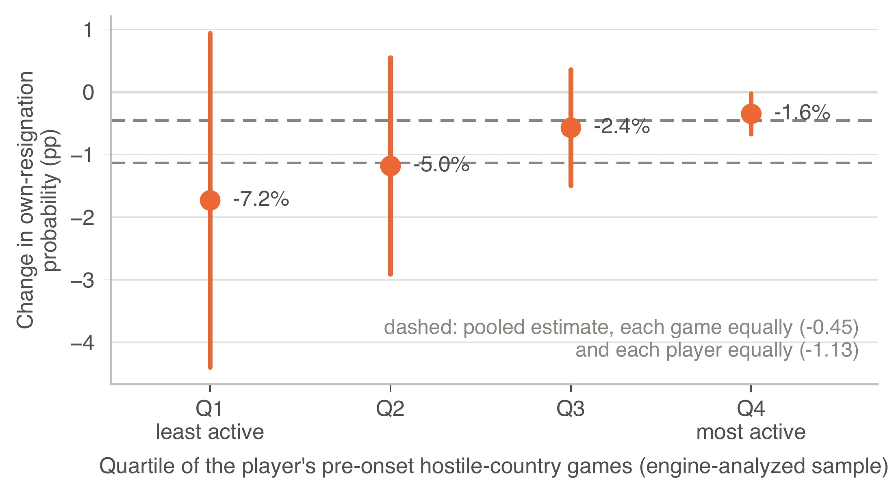

- The per-game estimate weights each player by games played, so a threefold gap means the most active players changed least

- Players grouped by how many hostile-country games they played before the war: estimates shrink from the least to the most active quarter and span the two averages (differences between quarters are imprecise)

- Occasional participants changed most: a comparison across players (less active players respond more), not an effect that fades within a player with repeated contact

.slide-links[

[backup: quartile table](#bk-activity) [backup: is anyone driving it?](#anyone) [FAQ: why equal weighting triples the estimate](#faq-weighting)

]

???

The per-game estimate weights each player by how much they play, so a threefold gap means the most active players changed least. The figure is the direct look: players grouped by how many hostile-country games they played before the war; the estimates shrink from the least to the most active quarter and span the two averages. The differences between quarters are imprecise, so the inference rests on the weighting comparison. The sentence that matters for this audience: occasional participants changed most. This is a comparison across players (less active players respond more), not an effect that fades within a player with repeated contact. If asked “is it learning?”: we tested it (exploratory, engine sample, not in the paper). We numbered each player’s post-onset hostile games in order of play and let the effect vary by that order. It does not fade: the effect for a player’s first hostile game after onset is no larger than for later ones (log- order interaction essentially zero, p = .88), and the profile is flat among heavy players too. Details: docs/20261003_comment_tests_exploration.md.
